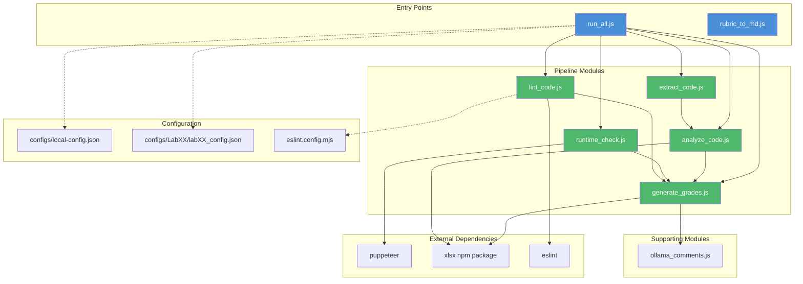
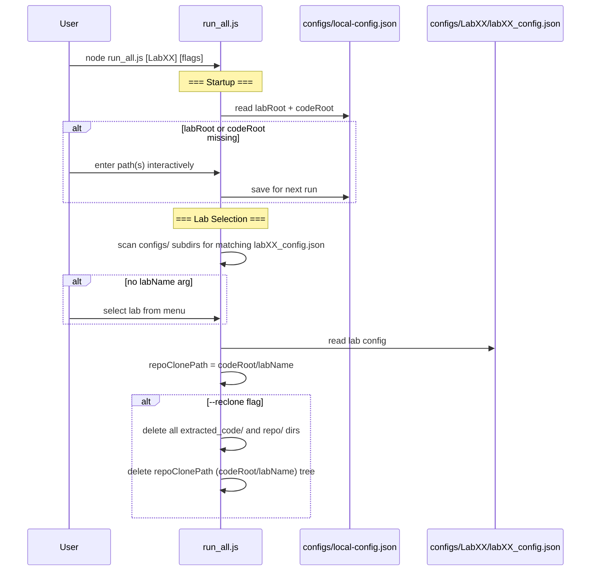
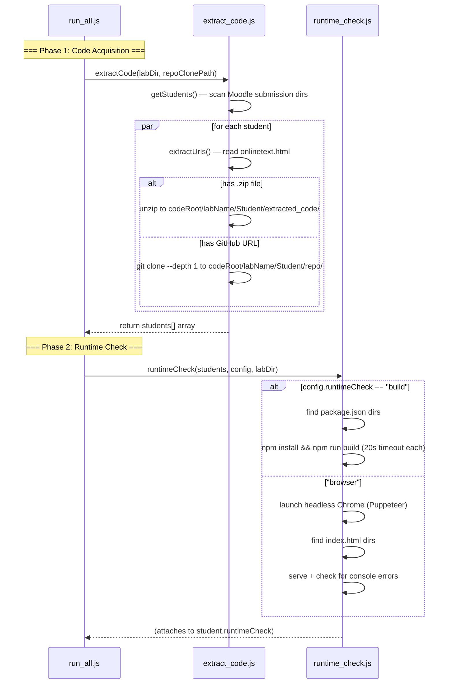
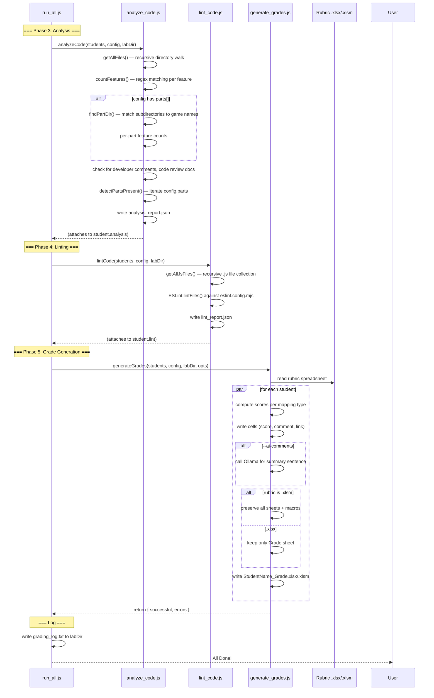
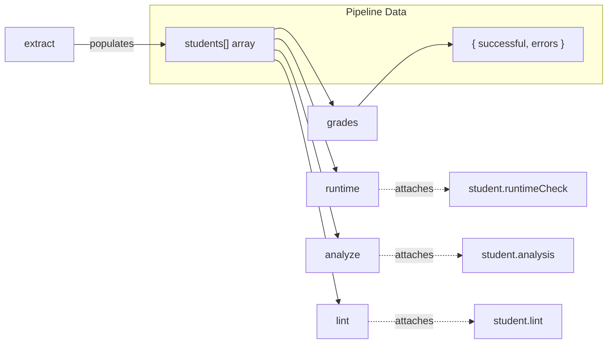

# CS233JS AI Grader — Developer Guide


[TOC]


---

## Module Dependency Diagram



---

## Startup & Configuration Flow



## Pipeline Phases 1-2: Code Acquisition & Runtime Check



## Pipeline Phases 3-5: Analysis, Lint & Grade Generation



---

## File-by-File Reference

### `run_all.js` — Master Orchestrator

The entry point. Handles CLI argument parsing, interactive menus, env configuration, and orchestrates the five pipeline phases.

**Key behaviors:**
- Reads `labRoot` and `codeRoot` from `AI_Grading/configs/local-config.json` (prompts & saves if missing; migrates from old `env.json` automatically)
- Scans `configs/` for subdirectories containing a matching `labXX_config.json` to build the lab menu
- Computes `repoClonePath = <codeRoot>/<labName>` so different labs' extracted code stays in separate subdirectories
- `--reclone` wipes both old-style dirs (inside submission folders) and the `<codeRoot>/<labName>` tree
- Validates config on startup — checks required keys, known mapping types, cell reference format, part structure, feature definitions
- Each phase attaches data directly to the shared `students` array; `generate_grades` reads from the student objects
- Writes `grading_log.txt` to `labDir` on completion

### `extract_code.js` — Code Acquisition

Handles extracting student code from submissions.

| Function | Purpose |
|---|---|
| `readFileWithTimeout()` | Read a file with a 10s timeout guard (protects against Google Drive blocking reads) |
| `normalizeGithubUrl()` | Normalize various GitHub URL formats to `https://github.com/owner/repo.git` |
| `getGithubSubdir()` | Extract subdirectory path from tree URLs (e.g., `/tree/main/Lab04` → `Lab04`) |
| `getStudents()` | Scan lab directory for Moodle submission folders matching `Name_ID_assignsubmission_*` |
| `extractUrls()` | Parse `onlinetext.html` for citstudent and GitHub URLs |
| `extractStudentCode()` | Unzip or git clone per student; sets `student.extractedDir` |

**Directory naming:**
- GitHub clones → `<codeRoot>/<labName>/StudentName/repo/`
- ZIP extractions → `<codeRoot>/<labName>/StudentName/extracted_code/`

If `codeRoot` is not configured (first run), falls back to placing code inside the student's submission directory on Google Drive.

**Git clone safety:**
- 60-second timeout with SIGKILL to prevent hangs
- `--depth 1` for shallow clones (faster)

### `runtime_check.js` — Runtime Error Detection

Two modes, controlled by `config.runtimeCheck`:

**`"build"` mode:**
- Recursively finds `package.json` files (skipping `node_modules`, hidden, and `dist` dirs)
- For each: runs `npm install --no-fund --no-audit --ignore-scripts` then `npm run build`
- Both commands have a 20-second timeout

**`"browser"` mode:**
- Launches headless Chrome via Puppeteer
- Finds all `index.html` files (recursively)
- Serves each directory on a random port
- Tracks JS runtime exceptions and failed script/stylesheet loads
- Waits for `networkidle0` plus 2s for delayed execution

### `analyze_code.js` — Feature Detection

Regex-based analysis of student JavaScript files.

**Key logic:**
- `getAllFiles()` — recursive directory walk (skips symlinks to prevent infinite loops from circular references)
- `countFeatures()` — counts regex matches per feature. Each feature is filtered to matching files via its `fileRegex` field (defaults to `.js` files). JS files have comments stripped before matching; other file types are searched as-is.
- `findPartDir()` — multi-pass search for part subdirectories (game name matching, folder pattern fallback)
- Checks for developer comments (name/date markers in files) and code review documents
- `detectPartsPresent()` — scans extracted directory for part subdirectories; auto-detects `part1`, `part2`, etc. even without explicit `parts` config. Results stored in `analysis.partPresence`
- **Custom analyzer hook** — `config.analysis.customAnalyzer` specifies a JS module (relative to `configs/LabXX/`) that receives `(jsFiles, analysis, config, student)` and can mutate `analysis` directly. Enables lab-specific checks beyond regex (e.g., Lab02's `modules` feature requires both `import` AND `export`, implemented in `configs/Lab02/lab02_analyzer.js`)

### `lint_code.js` — ESLint Runner

Runs ESLint v9+ with flat config.

- Loads ESLint from `eslint.config.mjs` in the AI_Grading directory
- `getAllJsFiles()` collects `.js` files recursively, respecting per-lab exclusions (e.g., `node_modules`, `dist`, `part1`)
- Outputs human-readable rule descriptions (42 rules mapped)
- Writes `lint_report.json`

### `generate_grades.js` — Rubric Spreadsheet Filler

Reads the rubric template and writes per-student graded spreadsheets.

**Handler registry:** Mapping types are registered via `registerHandler(type, fn)`. External modules can add new types without editing this file. The exported `VALID_MAPPING_TYPES` Set is built dynamically from the registry (imported by `run_all.js` for config validation).

**Cell mapping types:**

| Type | Auto-grades? | Behavior |
|---|---|---|
| `feature` | Yes | Score based on feature count vs. `minCount` |
| `part1_completed` | Yes | Score if Part 1 files exist (reads `analysis.partPresence.part1`) |
| `part_completed` | Yes | Generic version — checks `analysis.partPresence[partId]` |
| `apps_in_repo` | Yes | Score if all parts found in GitHub repo |
| `developer_comments` | Yes | Score if name/date markers found |
| `code_review` | Yes | Score if review document found |
| `url_check` | Partial | Writes URL for manual verification; score left blank |
| `lint` | Yes | Score based on ESLint issue count |
| `build_check` | Yes | Score based on build/run success |
| `manual` | No | Writes "NEEDS MANUAL CHECK" — instructor fills in |
| `part_feature` | Yes | Per-part feature check — reads `analysis.partFeatures[partId][featureId]` |

**Per-part feature pipeline:** `featureCounts` entries in `config.parts[].featureCounts` are converted to `part_feature`-type virtual mappings and processed through the same handler pipeline. This means per-part and top-level scoring share the same logic; no separate code path is needed.

**Macro support:** When the rubric is `.xlsm`, all sheets are preserved and VBA macros are written back. When `.xlsx`, only the `Grade` sheet is kept.

**AI summaries:** With `--ai-comments`, calls `ollama_comments.js` to generate a one-sentence summary for `config.summaryCell`.

### `ollama_comments.js` — AI Summary Generator

Hits a local Ollama instance (`http://localhost:11434`) to generate one-sentence rubric summaries.

- Discovers available models via `/api/tags`
- Sends a prompt with feature counts, lint issues, and runtime results
- Requests a 20-word-max sentence at `temperature: 0`
- Retries up to 3 times with exponential backoff (1s, 2s, 4s) to handle cold-start delays
- Returns `null` if all retries fail — caller falls back to placeholder text

### `rubric_to_md.js` — Standalone Utility

Dumps a rubric spreadsheet's Grade sheet as Markdown. Not part of the grading pipeline.

Usage: `node rubric_to_md.js path/to/Rubric.xlsm [output.md]`

---

## Configuration Reference

### `configs/local-config.json`

```json
{
  "labRoot": "/path/to/StudentLabWork",
  "codeRoot": "/path/to/local/GradingCode"
}
```

Machine-specific. Gitignored. Created on first run. Both paths are prompted for interactively if missing:

| Field | Description |
|---|---|
| `labRoot` | The Google Drive folder containing all lab directories (e.g., `StudentLabWork`) |
| `codeRoot` | A local folder **outside** Google Drive where student code is cloned/unzipped. The grader creates a `<labName>/` subfolder inside it automatically, so different labs' code stays separate |

On first run after upgrading from the old `env.json` / `_env.json` layout, `labRoot` is read from `env.json` automatically; `codeRoot` will be prompted for once and saved.

### `configs/LabXX/labXX_config.json` schema

```json
{
  "rubricName": "CS233JS_LabXX_Rubric.xlsx",
  "titleCell": "A1",
  "titleText": "Lab X: Title",
  "summaryCell": "A2",
  "runtimeCheck": "build" | "browser",
  "lint": {
    "exclude": ["node_modules", "dist"]
  },
  "analysis": {
    "features": [
      {
        "id": "feature_name",
        "regex": "regex pattern",
        "fileRegex": "\\.js$"
      }
    ],
    "customAnalyzer": "labXX_analyzer.js"
  },
  "parts": [
    {
      "id": "part1",
      "rubricTitleRow": 7,
      "folderPattern": "regex pattern",
      "featureCounts": [
        { "featureId": "classes", "minCount": 1, "cell": "C8", "commentCell": "E8", "maxScore": 5 }
      ]
    }
  ],
  "mappings": [
    { "cell": "C10", "commentCell": "E10", "type": "feature", "featureId": "modules", "maxScore": 6 }
  ]
}
```

| Field | Required | Description |
|---|---|---|
| `rubricName` | Yes | Filename of the rubric spreadsheet in the lab directory |
| `titleCell` | No | Cell to write the lab title |
| `titleText` | No | Lab title text |
| `summaryCell` | No | Cell for the AI-generated or manual summary comment |
| `runtimeCheck` | Yes | `"build"` or `"browser"` |
| `lint.exclude` | No | Path substrings to skip during linting |
| `analysis.features` | Yes | Array of features to detect via regex |
| `analysis.customAnalyzer` | No | Path (relative to `configs/LabXX/`) to a JS module for lab-specific analysis |
| `parts` | No | Multi-part lab configuration |
| `mappings` | Yes | Array of rubric cell assignments |

## Adding a New Lab

1. Create `configs/LabXX/` (e.g., `configs/Lab05/`)
2. Create `configs/LabXX/labXX_config.json` following the schema above
3. Copy the rubric spreadsheet (`CS233JS_LabXX_Rubric.xlsx` or `.xlsm`) into `configs/LabXX/`
4. (Optional) Create `configs/LabXX/labXX_analyzer.js` if the lab needs custom analysis beyond regex-based feature counting. The module should export a function `(jsFiles, analysis, config, student)` and return an object to merge into `analysis`
5. Run `node run_all.js` — the new lab will appear in the menu automatically (the menu scans `configs/` subdirectories for a matching `labXX_config.json`)

## Data Flow



Each phase attaches its results directly to each student object. After extraction, students carry `filesDir`, `extractedDir`, `urls`. The runtime check attaches `student.runtimeCheck`, analysis attaches `student.analysis` (features, `partFeatures`, `partPresence`, code review flags, custom analyzer output), and lint attaches `student.lint`. The grade generator reads all data from the student objects — no name-based joins needed.

## Google Drive Considerations

The lab directories live on Google Drive, which uses on-demand file syncing. This causes two issues:

1. **File reads can block** — `fs.readFileSync()` on an unsynced file hangs while Google Drive downloads it. Mitigated by `readFileWithTimeout()` in `extract_code.js` and the `codeRoot` setting that moves code off the cloud drive.

2. **Recursive directory walks can hang** — walking a directory tree on Google Drive triggers sync for each directory entry. Mitigated by skipping symlinks (`fs.lstatSync` instead of `fs.statSync`) and excluding `node_modules`, `dist`, and hidden directories.

3. **Git operations on Google Drive** — `git clone` writing to a Google Drive path can stall. All code extraction uses `codeRoot` which should point to a local (non-cloud) filesystem.
