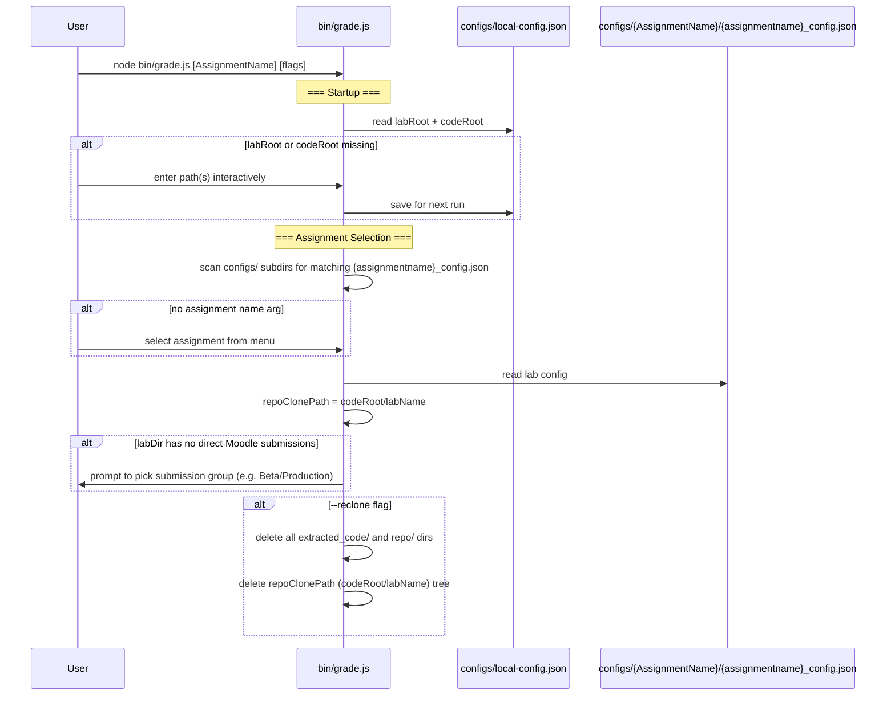
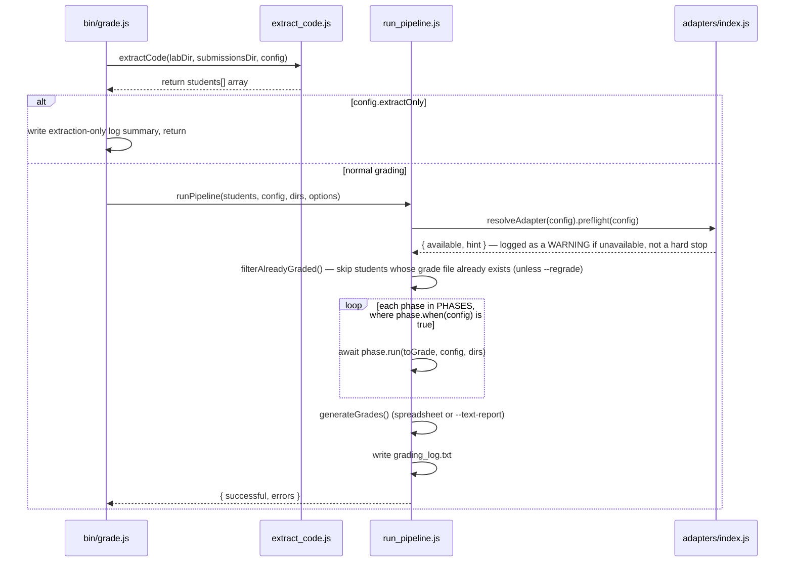
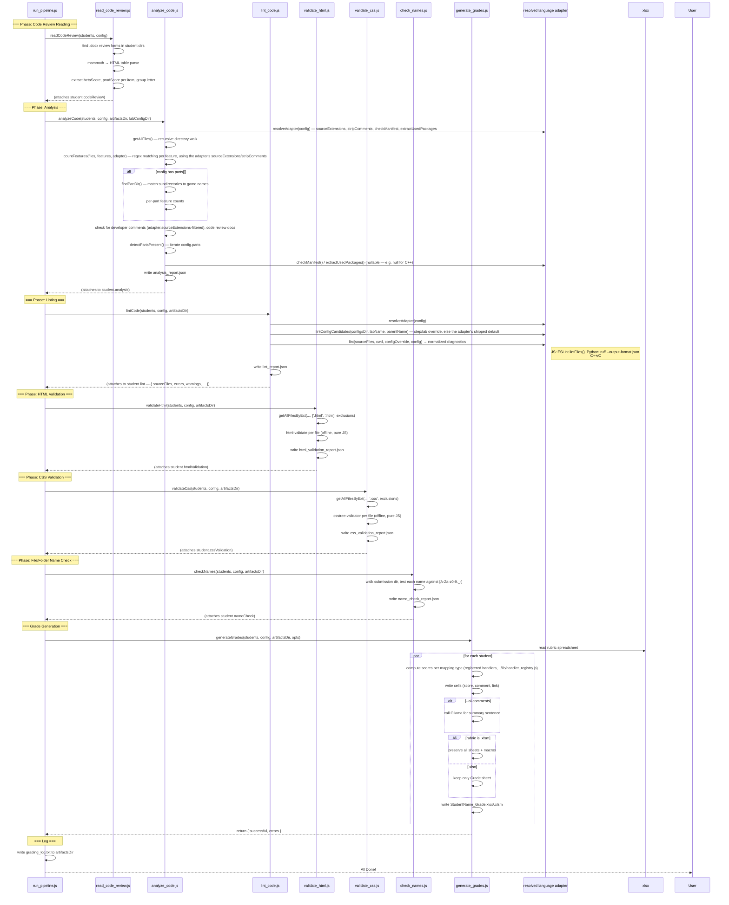
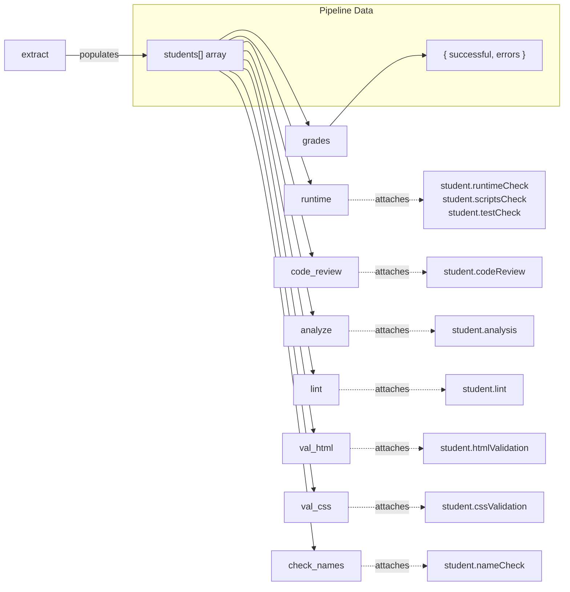

# CS233JS AI Grader — Developer Guide


[TOC]


---

## Module Dependency Diagram

```mermaid
graph TD
    subgraph "Entry Points"
        grade[bin/grade.js]
        rubric_to_md[bin/rubric-to-md.js]
        configure_lab[bin/configure-lab.js]
    end

    subgraph "Orchestrator"
        run_pipeline[run_pipeline.js]
    end

    subgraph "Pipeline Modules"
        extract[extract_code.js]
        runtime[runtime_check.js]
        code_review[read_code_review.js]
        analyze[analyze_code.js]
        lint[lint_code.js]
        val_html[validate_html.js]
        val_css[validate_css.js]
        check_names[check_names.js]
        grades[generate_grades.js]
    end

    subgraph "Language Adapters"
        adapter_index[adapters/index.js]
        adapter_js[adapters/javascript.js]
        adapter_ts[adapters/typescript.js]
        adapter_py[adapters/python.js]
        adapter_cpp[adapters/cpp.js]
        adapter_cs[adapters/csharp.js]
    end

    subgraph "Supporting Modules"
        ollama[ollama_comments.js]
        file_walker[file_walker.js]
        handler_registry[handler_registry.js]
        sandbox[sandbox.js]
        lab_config[lab_config.js]
        llm_client[llm_client.js]
        tui[tui.js]
        config_prompts[config_prompts.js]
    end

    subgraph "External Dependencies"
        puppeteer
        xlsx_npm[xlsx npm package]
        eslint
        html_validate[html-validate]
        csstree[csstree-validator]
    end

    subgraph "Configuration"
        local_config[configs/local-config.json]
        lab_configs[configs/{AssignmentName}/{assignmentname}_config.json]
        eslint_config[eslint/student.eslint.config.mjs]
    end

    %% Entry → Orchestrator → Pipeline
    grade --> extract
    grade --> run_pipeline
    run_pipeline --> runtime
    run_pipeline --> code_review
    run_pipeline --> analyze
    run_pipeline --> lint
    run_pipeline --> val_html
    run_pipeline --> val_css
    run_pipeline --> check_names
    run_pipeline --> grades

    %% Config loading
    grade -.-> local_config
    grade -.-> lab_configs
    grade -.->|handlerModules, before validateConfig| handler_registry

    %% Adapter resolution — every language-specific phase resolves an adapter by config.language
    runtime --> adapter_index
    analyze --> adapter_index
    lint --> adapter_index
    run_pipeline --> adapter_index
    adapter_index --> adapter_js
    adapter_index --> adapter_ts
    adapter_index --> adapter_py
    adapter_index --> adapter_cpp
    adapter_index --> adapter_cs
    adapter_ts -.->|extends| adapter_js

    %% Module internal deps
    grades --> ollama
    grades --> handler_registry
    val_html --> file_walker
    val_css --> file_walker
    check_names --> file_walker
    lint --> file_walker
    analyze --> file_walker
    runtime --> sandbox
    configure_lab --> tui
    configure_lab --> lab_config
    configure_lab --> llm_client
    configure_lab --> config_prompts
    config_prompts --> lab_config

    %% External deps (JS adapter only — other adapters shell out to their own toolchains)
    runtime --> puppeteer
    grades --> xlsx_npm
    adapter_js --> eslint
    adapter_js -.-> eslint_config
    val_html --> html_validate
    val_css --> csstree

    %% Data flow direction (for readability)
    extract --> analyze
    analyze --> grades
    runtime --> grades
    lint --> grades
    val_html --> grades
    val_css --> grades
    check_names --> grades

    style grade fill:#4a90d9,color:#fff
    style rubric_to_md fill:#4a90d9,color:#fff
    style configure_lab fill:#4a90d9,color:#fff
    style run_pipeline fill:#d98c4a,color:#fff
    style extract fill:#50b86c,color:#fff
    style runtime fill:#50b86c,color:#fff
    style code_review fill:#50b86c,color:#fff
    style analyze fill:#50b86c,color:#fff
    style lint fill:#50b86c,color:#fff
    style val_html fill:#50b86c,color:#fff
    style val_css fill:#50b86c,color:#fff
    style check_names fill:#50b86c,color:#fff
    style grades fill:#50b86c,color:#fff
    style adapter_index fill:#9b59b6,color:#fff
    style adapter_js fill:#9b59b6,color:#fff
    style adapter_ts fill:#9b59b6,color:#fff
    style adapter_py fill:#9b59b6,color:#fff
    style adapter_cpp fill:#9b59b6,color:#fff
    style adapter_cs fill:#9b59b6,color:#fff
```

`bin/grade.js` performs code acquisition (`extract_code.js`) and the `extractOnly` short-circuit directly, then hands the extracted `students[]` array to `run_pipeline.js`'s `runPipeline()`, which runs the remaining phases (a data-driven list, not a hardcoded sequence — see "Pipeline Orchestration" below) plus grade generation and the log summary. Every phase that used to hardcode JS/npm/ESLint logic now resolves a **language adapter** (`src/adapters/`, keyed by `config.language`, default `"javascript"`) and delegates the language-specific mechanics to it.

---

## Startup & Configuration Flow



## Pipeline Orchestration: run_pipeline.js

`bin/grade.js` calls `extractCode()` directly, handles the `extractOnly` short-circuit, then
calls `runPipeline(students, config, dirs, options)`. The phase list is data — an array of
`{ name, run, when }` entries (`PHASES` in `run_pipeline.js`) — rather than a hardcoded
sequence of awaits, so a future per-language config key can gate a phase (e.g. skip HTML/CSS
validation for a non-web language) without touching the loop.



## Pipeline Phases 1–2: Code Acquisition & Runtime Check

```mermaid
sequenceDiagram
    participant grade as bin/grade.js
    participant extract as extract_code.js
    participant pipeline as run_pipeline.js
    participant runtime as runtime_check.js
    participant adapter as resolved language adapter

    Note over grade: === Phase 1: Code Acquisition ===
    grade->>extract: extractCode(labDir, submissionsDir, config)
    extract->>extract: getStudents() — scan Moodle submission dirs
    par for each student
        extract->>extract: extractUrls() — categorize URLs per config.urlPatterns (default: github, citstudent)
        alt has .zip file
            extract->>extract: unzip to submissionsDir/Student/extracted_code/
        else has GitHub URL
            extract->>extract: git clone --depth 1 to submissionsDir/Student/repo/
        end
    end
    extract-->>grade: return students[] array

    Note over pipeline: === Phase: Runtime Check (registerCheckStrategy) ===
    pipeline->>runtime: runtimeCheck(students, config, artifactsDir)
    runtime->>runtime: strategy = getCheckStrategy(config.runtimeCheck || "build")
    alt strategy == "build"
        runtime->>adapter: detectProject(dir, config) → Project[]
        runtime->>adapter: install(project, config), then build(project, config)
    else "browser"
        runtime->>runtime: launch headless Chrome (Puppeteer) — generic, not adapter-specific
        runtime->>runtime: find index.html dirs, serve + check for console errors
    else "both"
        runtime->>adapter: build phase first (as above)
        runtime->>runtime: then browser phase on the built dist/
        runtime->>runtime: store buildSuccess + browserSuccess separately
    else "run_check"
        runtime->>adapter: build (if needed), then execute the artifact
        runtime->>runtime: (sandbox) runStudentArtifact() — see sandbox.js below
        runtime->>runtime: match stdout against config.runCheck.expectPatterns
    end
    alt scripts_check mappings present
        runtime->>adapter: runScript(project, name) per configured script (adapter-delegated; null for languages with no named-script concept)
        runtime-->>pipeline: attaches student.scriptsCheck
    end
    alt test_check mappings present
        runtime->>adapter: runTests(project, config) — pytest/dotnet test/CTest, per language
        runtime-->>pipeline: attaches student.testCheck
    end
    runtime-->>pipeline: (attaches to student.runtimeCheck)
```

### `src/lib/sandbox.js` — Native Code Execution Isolation

The `run_check` strategy never spawns the student artifact directly — it calls
`runStudentArtifact(argv, execConfig)`, the single isolation chokepoint every current and
future build/run/test strategy must go through.

- **`"direct"` mode** (implemented, the default): spawns the artifact from a **fresh,
  throwaway temp working directory** (so relative-path file writes/deletes the student
  program makes land somewhere disposable, not the real submission tree), with a
  timeout + kill-tree (`taskkill /T /F` on Windows, negative-PID `SIGKILL` on POSIX —
  the same pattern already used for npm script execution). This is **not a security
  sandbox** — it protects against accidental damage (infinite loops, runaway child
  processes) from bugs in trusted-classroom submissions, not deliberately malicious code.
- **`"restricted-user"`** and **`"container"`** are documented, loud-failing stubs — requesting
  either throws `execution.mode "..." is not implemented` rather than silently falling back
  to `"direct"`. `"container"` (Docker/Podman) is the real second isolation tier for when
  genuine confinement is actually needed; implement it if a future course involves
  less-trusted submissions.
- Configured via `config.execution: { mode, timeoutMs }`; the file's own header comment is
  the canonical isolation-tier documentation.

## Pipeline Phases 3–6: Analysis, Validation & Grading

All of these phases are entries in `run_pipeline.js`'s `PHASES` list, invoked in order by
the loop shown in "Pipeline Orchestration" above.



---

## File-by-File Reference

### `bin/grade.js` — CLI Entry Point

Handles CLI argument parsing, interactive menus, env configuration, and code
acquisition, then hands off to `src/pipeline/run_pipeline.js` for phase orchestration
(see "Pipeline Orchestration" above) — it is no longer the module that calls
`runtimeCheck`/`analyzeCode`/etc. directly.

**Key behaviors:**
- Reads `labRoot` and `codeRoot` from `AI_Grading/configs/local-config.json` (prompts & saves if missing; tries `default-config.json` as fallback for new machines; migrates from old `env.json` automatically). Also reads an optional `toolchains` section (machine-specific compiler/interpreter paths, e.g. for a MinGW g++ install not on PATH) and merges it into `config.toolchains`, with the lab config allowed to override individual entries.
- Scans `configs/` for subdirectories containing a matching `{assignmentname}_config.json` to build the assignment menu
- Computes `submissionsDir = <codeRoot>/<labName>/SubmissionsAndAssessment` and `artifactsDir = <codeRoot>/<labName>/Artifacts`
- `--reclone` wipes both old-style dirs (inside submission folders) and the `<codeRoot>/<labName>` tree
- `--regrade` without `--reclone` runs `git pull` on each student's existing repo before re-grading
- When `labDir` has no direct Moodle submissions but contains subdirs that do (e.g. separate Beta/Production groups), prompts the user to pick which group to grade
- Loads `config.handlerModules` (external mapping-type handler modules) **before** validating the config — a mapping type registered by one of those modules must already be recognized as valid when `validateConfig()` checks every mapping's `type` against `VALID_MAPPING_TYPES`. This ordering fixed a real bug where handler modules were previously loaded too late (inside `generate_grades.js`, after validation had already run).
- Validates config on startup — checks required keys, known mapping types (`VALID_MAPPING_TYPES`, sourced from `../lib/handler_registry.js`), runtime-check mode (`VALID_RUNTIME_MODES`, sourced from `runtime_check.js`'s check-strategy registry — new strategies don't require editing the validator), cell reference format, part structure, feature definitions
- Calls `extractCode(labDir, submissionsDir, config)` directly; for `config.extractOnly` labs, writes the extraction-only log summary and returns without calling `run_pipeline.js` at all
- Otherwise calls `runPipeline(students, config, dirs, options)`, which filters out already-graded students (unless `--regrade`), runs the phase list, generates grades, and writes `grading_log.txt` — see `run_pipeline.js` below

### `extract_code.js` — Code Acquisition

Handles extracting student code from submissions.

| Function | Purpose |
|---|---|
| `readFileWithTimeout()` | Read a file with a 10s timeout guard (protects against Google Drive blocking reads) |
| `normalizeGithubUrl()` | Normalize various GitHub URL formats to `https://github.com/owner/repo.git` |
| `getGithubSubdir()` | Extract subdirectory path from tree URLs (e.g., `/tree/main/Lab04` → `Lab04`) |
| `getStudents()` | Scan lab directory for Moodle submission folders matching `Name_ID_assignsubmission_*` |
| `extractUrls(textDir, urlPatterns)` | Parse `onlinetext.html` for URLs matching each configured category (default `{ github: "github.com", citstudent: "citstudent.lanecc.edu" }`, overridable via `config.urlPatterns`) |
| `extractStudentCode()` | Unzip or git clone per student; sets `student.extractedDir` |

**Directory naming:**
- GitHub clones → `<codeRoot>/<labName>/SubmissionsAndAssessment/StudentName/repo/`
- ZIP extractions → `<codeRoot>/<labName>/SubmissionsAndAssessment/StudentName/extracted_code/`

**Git clone safety:**
- 60-second timeout with SIGKILL to prevent hangs
- `--depth 1` for shallow clones (faster)

**Config-driven URL categories:** `github` is structurally special — it decides whether
the pipeline clones a repo or falls back to extracting a zip. Any other key in
`config.urlPatterns` is just a label, matched against a hostname substring, consumed by
`url_check`/`deploy_check` mapping types via their `urlType` field. Existing labs need no
config changes — the default preserves the original hardcoded behavior exactly.

### `runtime_check.js` — Runtime Check Strategy Registry

Dispatches to a named check **strategy**, registered via
`registerCheckStrategy(name, fn, opts)` — the same registry pattern as
`generate_grades.js`'s mapping-type handlers. `VALID_RUNTIME_MODES` (a `Set`, exported
and used by `bin/grade.js`'s config validation) is populated automatically as strategies
register, so a new strategy doesn't require editing the validator.

**`"build"` strategy:**
- Delegates project discovery and build mechanics to the resolved language adapter: `adapter.detectProject(dir, config)` → `Project[]`, then `adapter.install(project, config)` (nullable — e.g. `null` for C++/C#, which have nothing to install) and `adapter.build(project, config)`
- For the JS adapter specifically: finds `package.json` dirs (skipping `node_modules`, hidden, `dist`), deletes any existing `node_modules/` (prevents committed `node_modules` from having broken `.bin/` symlinks), runs `npm install --no-fund --no-audit --ignore-scripts` then `npm run build`, both with a 20-second timeout
- Other adapters: TypeScript runs `tsc --noEmit` (via the grader's own locally-installed `node_modules/.bin/tsc`, not the student's); Python runs `py_compile` per file (syntax-only, no real build step exists); C++ compiles loose `.cpp` files directly or shells out to `cmake`/`make`; C# runs `dotnet build`

**`"browser"` strategy** (generic — not language-specific):
- Launches headless Chrome via Puppeteer
- Finds all `index.html` files (recursively)
- Serves each directory on a random port
- Tracks JS runtime exceptions and failed script/stylesheet loads
- Waits for `networkidle0` plus 2s for delayed execution

**`"both"` strategy:**
- Runs the full build phase first, storing results as `buildSuccess` / `buildErrors`
- Then runs the browser phase on the built output, storing results as `browserSuccess` / `browserErrors`
- Use `build_check`, `browser_check`, or `build_and_browser_check` mapping types to score each sub-result

**`"run_check"` strategy:**
- Builds first (if the adapter has a build step and the project has no static `runCommand` — interpreted languages like Python skip straight to running)
- Executes the produced artifact via `../lib/sandbox.js`'s `runStudentArtifact()` chokepoint (see that section above) — this strategy never spawns the artifact itself
- Matches combined stdout against `config.runCheck.expectPatterns` (all must match); `config.runCheck.stdin` is fed to the program; `config.runCheck.timeoutMs` (default 10000) is the kill-tree timeout
- Intended for non-web languages whose runtime signal is "did the program run and produce the right output," not a browser check — score with the `run_check` mapping type

**Scripts check sub-phase:**
- Automatically runs when any `scripts_check` mapping is present in the config
- Delegates to `adapter.runScript(project, name, opts)` (nullable — `null` for languages with no npm-style named-script concept, e.g. Python/C++/C#)
- For JS: verifies the specified npm scripts (e.g. `dev`, `build`, `preview`) are defined and exit 0. Server-starting script names (`dev`, `start`, `serve`, `watch`, `preview`) are only checked for being *defined*, never actually run — this is pipeline-level policy (`SERVER_SCRIPTS` in `runtime_check.js`), not something the adapter decides.
- Results stored in `student.scriptsCheck`

**Test check sub-phase:**
- Automatically runs when any `test_check` mapping is present in the config
- Delegates to `adapter.runTests(project, config)` (nullable — implemented for Python via `pytest`, and C# via `dotnet test`; `null` for JS/C++ — no test-runner integration for those yet)
- Returns `{ total, passed, failures[] }`; results stored in `student.testCheck`, scored proportionally by the `test_check` mapping type

### `read_code_review.js` — Code Review Reader

Runs **before** `analyze_code.js` so the group letter is available during analysis.

- Finds `.docx` code review forms in each student's submission folder
- Uses `mammoth` to convert the docx to HTML, then parses the table
- Extracts per-item beta and production scores, `productionCompleted` flag, and group letter (`A`/`B`/`C`)
- Attaches `student.codeReview` with `{ found, items[{betaScore, prodScore}], productionCompleted, group }`

### `analyze_code.js` — Feature Detection

Regex-based analysis of student source files, driven by the resolved language adapter
(`src/adapters/`, default `javascript`) rather than hardcoded `.js` assumptions.

**Key logic:**
- `getAllFiles()` — recursive directory walk (skips symlinks to prevent infinite loops from circular references)
- `countFeatures(files, features, adapter)` — counts regex matches per feature. Each feature is filtered to matching files via its `fileRegex` field, defaulting to the resolved adapter's `sourceExtensions` (`.js`/`.mjs` for JS, `.py` for Python, etc. — no longer hardcoded to `.js`). Source files (per `sourceExtensions`) have comments stripped via `adapter.stripComments()` before matching; other file types are searched as-is. The `adapter` parameter defaults to the JS adapter, so existing 2-arg callers (and tests) are unaffected.
- `findPartDir()` — multi-pass search for part subdirectories (game name matching, folder pattern fallback)
- Checks for developer comments (name/date markers in files), filtered to the adapter's `sourceExtensions` — checks for a specific 2-extension list
- Checks for code review documents
- `detectPartsPresent()` — scans extracted directory for part subdirectories; auto-detects `part1`, `part2`, etc. even without explicit `parts` config. Results stored in `analysis.partPresence`
- `config.packageCheck` validation and `analysis.npmPackages` population both delegate to `adapter.checkManifest()` / `adapter.extractUsedPackages()` — both nullable (e.g. `null` for C++, which has no manifest/package concept); when null, `analysis.npmPackages` is simply `[]` and no manifest check runs
- **Custom analyzer hook** — `config.analysis.customAnalyzer` specifies a JS module (relative to `configs/{AssignmentName}/`) that receives `(jsFiles, analysis, config, student)` and can mutate `analysis` directly. Enables lab-specific checks beyond regex (e.g., Lab02's `modules` feature requires both `import` AND `export`). **Deprecated** — see the Config Schema section; no analyzers currently exist.

### `lint_code.js` — ESLint Runner

Runs ESLint v9+ with flat config.

- Delegates the actual linting to the resolved language adapter (`src/adapters/`, default `javascript`), which resolves the ruleset (a `configs/{Lab}/eslint.config.mjs` override if present, else the shipped `eslint/student.eslint.config.mjs` for the JS adapter) and copies it into the lab folder for editor consistency. The JS adapter uses ESLint's Node API (`new ESLint().lintFiles()`), not a shelled-out CLI.
- Collects source files recursively per the adapter's `sourceExtensions` (`.js`/`.mjs` for JS), respecting per-lab exclusions (e.g., `node_modules`, `dist`, `part1`)
- Outputs human-readable rule descriptions (42 rules mapped, for the JS adapter)
- Writes `lint_report.json`
- Attaches `student.lint` with `{ sourceFiles, errors, warnings, errorMessages, warningMessages, messages, ruleCounts }`

### `validate_html.js` — HTML Validator

Validates HTML files using `html-validate` (pure JS, fully offline — no network calls).

- Collects `.html` and `.htm` files via `getAllFilesByExt`, respecting `config.validate.exclude`
- Runs `html-validate` with `html-validate:recommended` preset by default; `no-trailing-whitespace` is disabled (cosmetic, not a validity issue)
- Ruleset can be overridden per-lab via `config.validate.htmlExtends` (preset list) and `config.validate.htmlRules` (per-rule overrides)
- Aggregates results: error count, warning count, per-rule counts, top-N issue list
- Attaches `student.htmlValidation` with `{ htmlFiles, errors, warnings, messages, ruleCounts }`
- Writes `html_validation_report.json`

### `validate_css.js` — CSS Validator

Validates CSS files using `csstree-validator` (pure JS, fully offline).

- Collects `.css` files via `getAllFilesByExt`, respecting `config.validate.exclude`
- Reports parse/syntax errors only — no warning tier (csstree doesn't have one)
- Error names (e.g. `SyntaxReferenceError`, `SyntaxMatchError`) used as rule IDs in aggregation
- Attaches `student.cssValidation` with `{ cssFiles, errors, warnings: 0, messages, ruleCounts }`
- Writes `css_validation_report.json`

### `check_names.js` — File/Folder Name Checker

Checks every file and folder name in each student's submission for Linux/web portability.

- **Rule:** name is invalid if it contains any character outside `[A-Za-z0-9._-]`, starts with `-`, or exceeds 255 bytes. Spaces are called out distinctly. Uppercase is allowed; dotfiles (`.gitignore`) pass.
- Walks the submission tree with `walk()`, skipping `DEFAULT_SKIP_DIRS` and dot-directories
- `config.nameCheck.extraAllowed` adds extra allowed characters (e.g. `+` for certain frameworks)
- `config.validate.exclude` exclusion list also applies here
- Attaches `student.nameCheck` with `{ entriesChecked, errors, messages, badNames }`
- Writes `name_check_report.json`

### `src/pipeline/run_pipeline.js` — Phase Orchestrator

Extracted from `bin/grade.js` so the phase set is testable in isolation and data-driven
rather than a hardcoded sequence of awaits. See "Pipeline Orchestration" above for the
sequence diagram.

| Export | Purpose |
|---|---|
| `runPipeline(students, config, dirs, options)` | Runs `preflight` → `filterAlreadyGraded` → each phase in `PHASES` (skipping any whose `when(config)` is false) → `generateGrades` → the log summary. Returns `{ successful, errors }`. |
| `PHASES` | `[{ name, run(students, config, dirs), when(config) }]` — currently: `runtimeCheck`, `readCodeReview`, `analyzeCode`, `lintCode`, `validateHtml`, `validateCss`, `checkNames`, all with `when: () => true` today (every built-in phase runs unconditionally; a future per-language config key can flip one off without changing the loop). |
| `filterAlreadyGraded(students, config, options)` | Pure function — filters out students whose grade output file already exists, unless `options.regrade`. |
| `runPreflight(config)` | Calls the resolved adapter's `preflight(config)` once, upfront, logging a `console.warn` with the adapter's hint if the toolchain isn't available — informational only, not a hard gate (some mapping types don't need the toolchain at all). |

### `src/adapters/` — Language Adapters

Every phase above that used to hardcode JS/npm/ESLint logic now resolves a language
adapter via `resolveAdapter(config)` (`src/adapters/index.js`), keyed by `config.language`
(default `"javascript"`). See `src/adapters/base.js` for the full interface contract
(JSDoc typedefs for `Adapter`, `Project`, `Diagnostics`, `Manifest`) and its
`isValidDiagnostics()`/`REQUIRED_ADAPTER_KEYS` helpers, used by the adapter test suites
(`test/adapters/*.spec.mjs`).

Every method except `sourceExtensions`/`stripComments` is **nullable** — `null` means
"this language has no such concept" (e.g. `checkManifest: null` for C++), and callers
must treat that as a capability gap, not an error. Methods that shell out to an external
tool (`lint`, `install`, `build`, `runTests`, `preflight`) accept an optional trailing
`config` argument carrying `config.toolchains` (see the Configuration Reference below).

| Adapter | Manifest | Lint | Build | Tests | Notes |
|---|---|---|---|---|---|
| `javascript.js` (default) | `package.json` (dependencies/devDependencies split) | ESLint (Node API) | `npm install` + `npm run build` | — (`runTests: null`) | The original implementation, extracted verbatim — behavior for existing JS labs is unchanged |
| `typescript.js` | `package.json` (reuses the JS adapter's logic) | ESLint with `@typescript-eslint/parser` | `tsc --noEmit`, via the grader's own `node_modules/.bin/tsc` (not the student's) | — | Extends the JS adapter (`{ ...jsAdapter, ... }`) rather than reimplementing it |
| `python.js` | `requirements.txt` (flat — no dependencies/devDependencies split) | `ruff check --output-format json`, classified: pyflakes (`F`)/syntax errors (`E9`) = errors, else warnings | `py_compile` per file (syntax-only — Python has no separate compile step) | `pytest` (text-summary parsed, no JSON-report plugin dependency) | `runScript: null` — no npm-style named-script concept for plain submissions |
| `cpp.js` | none (`checkManifest: null`) | Compiler warnings via `-fdiagnostics-format=sarif-stderr` (g++/clang SARIF output) — same mechanism as `build()`, so `lint` re-runs the compile | Prefers CMakeLists.txt, then a Makefile, then compiles loose `.cpp`/`.cc`/`.cxx` files directly (only the "loose" path gets structured diagnostics) | not implemented (`runTests: null` — CTest/GoogleTest integration is a documented future step) | `stripComments` protects C++11 raw string literals (`R"(...)"`) before the generic string pass; header files (`.h`/`.hpp`) are scanned for features/lint but never independently compiled |
| `csharp.js` | none in this adapter (NuGet `PackageReference` validation not implemented) | MSBuild plain-text diagnostics from `dotnet build` (regex-parsed — no binlog/XML dependency) | `dotnet build` | `dotnet test` (console-summary line parsed, e.g. `Failed: 1, Passed: 2, ...`) | `detectProject` parses a `.sln`/`.slnx` (supports both the classic text format and the newer XML format the .NET SDK now defaults to) for multi-project references, or a loose `.csproj`; `stripComments` protects verbatim (`@"..."`) and C# 11 raw string literals |

**Adding a new adapter:** implement the `Adapter` interface from `base.js`, register it in
`src/adapters/index.js`'s `ADAPTERS` map (or call `registerAdapter(language, adapter)`),
and add its language name to `configure-lab.js`'s language picker if it should be
wizard-selectable.

### `generate_grades.js` — Rubric Spreadsheet Filler

Reads the rubric template and writes per-student graded spreadsheets.

**Handler registry:** Mapping types are registered via `registerHandler(type, fn)`, defined
in `../lib/handler_registry.js` (extracted from this file into its own lightweight module
so `bin/grade.js` can load `config.handlerModules` and validate mapping types before
importing this file's heavier `ollama_comments.js`/`rubric_writer.js` dependencies).
External modules can add new types without editing this file. The exported
`VALID_MAPPING_TYPES` Set is built dynamically from the registry (imported by
`bin/grade.js` for config validation). Wizard-facing metadata (labels/descriptions/field
prompts for `configure-lab.js`) still lives separately in `lib/lab_config.js`'s
`MAPPING_TYPES`/`MAPPING_TYPE_SCHEMA` — deliberately not merged into the handler registry
yet (a test in `test/generate_grades.spec.mjs` asserts the two lists describe the same
set of type names, so future drift between them is caught by CI rather than a human
noticing).

**Cell mapping types:**

| Type | Auto-grades? | Behavior |
|---|---|---|
| `feature` | Yes | Score based on feature count vs. `minCount` |
| `part1_completed` | Yes | Score if Part 1 files exist (reads `analysis.partPresence.part1`) |
| `part_completed` | Yes | Generic version — checks `analysis.partPresence[partId]` |
| `apps_in_repo` | Yes | Score if all parts found in GitHub repo |
| `developer_comments` | Yes | Score if name/date markers found |
| `code_review` | Yes | Full/half/zero based on review found + production column complete |
| `url_check` | Partial | Writes URL for manual verification; score left blank |
| `deploy_check` | Partial | Fetches the `urlType` URL (default `citstudent`); scores reachability + bundling (opt out via `checkBundling: false`); flags transient failures for manual review |
| `lint` | Yes | Score based on the resolved adapter's diagnostic issue count (ESLint for JS/TS, ruff for Python, compiler warnings for C++/C#). Optional `severity: "errors"` (binary pass/fail) or `"warnings"` (graduated). Default uses combined total. |
| `html_validate` | Yes | Score based on HTML error count; `tolerance` (default 3) sets half-point tier |
| `css_validate` | Yes | Score based on CSS error count; `tolerance` (default 3) sets half-point tier |
| `name_check` | Yes | Score based on invalid name count; `tolerance` (default 2) sets half-point tier |
| `build_check` | Yes | Score based on build success (from `"build"` or `"both"` mode) |
| `browser_check` | Yes | Score based on browser console errors (from `"browser"` or `"both"` mode) |
| `build_and_browser_check` | Yes | Full/half/zero based on both build and browser results combined |
| `run_check` | Yes | Score based on the `"run_check"` runtime strategy's result — full credit if the program ran and matched `config.runCheck.expectPatterns`, else 0 with the failure detail preserved |
| `test_check` | Yes | Proportional score against `student.testCheck` (`{ total, passed, failures[] }` from the adapter's `runTests` — pytest/dotnet test); comment lists up to 5 failing test names |
| `scripts_check` | Yes | Proportional score: how many of the specified named scripts pass (adapter-delegated; nullable for languages with no such concept) |
| `manual` | No | Reads production/beta score from code review form; falls back to "NEEDS MANUAL CHECK" |
| `part_feature` | Yes | Per-part feature check — reads `analysis.partFeatures[partId][featureId]` |
| `repo_hygiene` | Yes | Score if no excluded folders (e.g. `node_modules`, `dist`) are committed to the repo |
| `github_repo` | Yes | Score if a GitHub URL was provided and the repo was successfully cloned |
| `collaborator_check` | Yes | Score if GitHub repo was cloned (proxy for instructor being added as collaborator) |
| `gitignore_check` | Yes | Score if `.gitignore` file exists in the repo root |
| `npm_package` / `package_usage` | Yes | Score if any qualifying packages are imported (uses `analysis.npmPackages`, populated per-language by the resolved adapter's `extractUsedPackages`). `package_usage` is a language-neutral alias — same handler, use whichever name reads better. |
| `package_check` / `manifest_check` | Yes | Score if the dependency manifest contains the expected entries (uses `analysis.packageCheck`, populated by `adapter.checkManifest`). `manifest_check` is a language-neutral alias — same handler. |

**`stockComments`:** Any mapping may include `stockComments: { full, partial, zero }` — short strings written into the comment cell instead of the verbose auto-generated comment. Handlers that set `keepComment: true` (e.g. `deploy_check` manual-review flags, validation errors) are **not** overridden by `stockComments.zero`, so diagnostics are never silently erased.

**Per-part feature pipeline:** `featureCounts` entries in `config.parts[].featureCounts` are converted to `part_feature`-type virtual mappings and processed through the same handler pipeline. This means per-part and top-level scoring share the same logic; no separate code path is needed.

**Macro/button preservation (`.xlsm` only):** SheetJS strips drawing objects and VBA data when re-writing. After SheetJS writes the output file, `adm-zip` is used to: (1) copy drawing XML, VML, and control-property ZIP entries from the template; (2) patch the Grade sheet XML to re-inject `<drawing>` / `<legacyDrawing>` / `<controls>` elements and any missing namespace declarations; (3) re-add all non-Grade sheets as `state="veryHidden"` — required because the VBA binary references every original sheet module by code name, and Excel refuses to load the VBA project if any referenced sheet is missing. When `.xlsx`, only the `Grade` sheet is kept and no post-processing is needed.

**AI summaries:** With `--ai-comments`, calls `ollama_comments.js` to generate a one-sentence summary for `config.summaryCell`.

### `lib/file_walker.js` — Shared Directory Traversal

Used by analyze_code, lint_code, validate_html, validate_css, and check_names. Replaces several near-identical hand-rolled walkers.

**Exports:**

| Export | Purpose |
|---|---|
| `walk(dir, opts)` | Core pre-order DFS traversal. Callbacks: `visit`, `onFile`, `onDir`, `shouldSkip`, `shouldDescend`. Options: `followSymlinks` (default false), `maxDepth` (default Infinity). Unreadable dirs are silently skipped. |
| `getAllFilesByExt(dir, ext, exclusions)` | Collect all files with a given extension (or array of extensions). Skips `DEFAULT_SKIP_DIRS`, dot-directories, and any path matching an exclusion substring. |
| `DEFAULT_SKIP_DIRS` | `Set(['node_modules', 'dist', 'build', '.git', '__MACOSX'])` — dirs never scanned. |

### `lib/llm_client.js` — Unified LLM Client

Wraps Ollama, OpenRouter, and Anthropic behind a single `chat(systemPrompt, userPrompt)` interface.

- `LLMClient` — class with `chat()`, `_chatOpenAI()`, `_chatAnthropic()`, `_request()`
- `loadLLMClient(localConfigPath)` — reads `llm` block from `local-config.json`; resolves API key from environment first, then stored value
- `setupLLMInteractive(localConfigPath, driver)` — full guided provider/model/key setup; saves to `local-config.json`
- `selectModel(localConfigPath, driver)` — simplified 4-option picker used by `configure_lab.js`; shows current selection as default
- `detectOllamaModel()` — probes `localhost:11434/api/tags` for a running model name (2s timeout)
- On HTTP 429, automatically retries with `fallbackModel` if configured; otherwise retries up to 3 times with exponential backoff

### `lib/tui.js` — Terminal UI

Provides the full-screen interface for `configure_lab.js` using `neo-blessed`.

- Scrollable log pane (redirects `console.log`/`console.error` while active)
- `ask(prompt, def)` — text input bar with default; returns trimmed string
- `askBoolean(question, def)` / `askInt(prompt, def)` — typed wrappers over `ask()`
- `askOptions(prompt, opts, defIdx)` — centered popup list with arrow-key navigation; shows per-item description in a bottom bar
- `reviewTable(makeItems, editRow)` — full-screen navigable table for reviewing/editing draft mappings before accepting
- `showSpinner(msg)` / `clearSpinner()` — floating overlay for async operations

### `ollama_comments.js` — AI Summary Generator

Hits a local Ollama instance (`http://localhost:11434`) to generate one-sentence rubric summaries.

- Discovers available models via `/api/tags`
- Sends a prompt with feature counts, lint issues, and runtime results
- Requests a 20-word-max sentence at `temperature: 0`
- Retries up to 3 times with exponential backoff (1s, 2s, 4s) to handle cold-start delays
- Returns `null` if all retries fail — caller falls back to placeholder text

### `rubric_to_md.js` — Standalone Utility

Dumps a rubric spreadsheet's Grade sheet as Markdown. Not part of the grading pipeline.

Usage: `node bin/rubric_to_md.js path/to/Rubric.xlsm [output.md]`

### `configure_lab.js` — Assignment Configuration Wizard

Interactive CLI tool to create a new lab or assignment configuration from scratch. Not part of the grading pipeline.

Usage: `node bin/configure_lab.js [AssignmentName]`

**Key functions (testable via `lib/lab_config.js` and `lib/config_prompts.js`):**
| Function | Module | Purpose |
|---|---|---|
| `normalizeAssignmentName(input)` | `lab_config.js` | Digits-only → `"Lab07"`; `Lab`-prefixed → normalized `"Lab07"`; other slug (e.g. `"TermProject"`) → returned as-is |
| `colLetter(idx)` / `excelCell(col, row)` | `lab_config.js` | Build Excel cell references (e.g., `"C7"`) |
| `readRubricRows(path, labelOrLayout?)` | `lab_config.js` | Reads the Grade sheet from a rubric via xlsx, returns structured row objects |
| `buildConfig(labName, responses)` | `lab_config.js` | Assembles a `{assignmentname}_config.json` object from wizard responses |
| `buildMappingEntry(driver, type, rubricRow)` | `config_prompts.js` | Creates a single mapping entry with type-specific fields |
| `copyRubric(driver, labName)` | `config_prompts.js` | Prompts for a rubric file path, suggests canonical name, returns `{ rubricPath, rubricName, ext }` |

**Input mechanism:** Uses a `driver` abstraction (`{ ask, askBoolean, askInt, askOptions, print, exit }`) so the wizard logic is testable independently of the TUI. The TUI implementation lives in `configure_lab.js`; tests use a `mockDriver` factory in `test/configure_lab.spec.mjs`.

Tests live in `test/configure_lab.spec.mjs`.

---

## Configuration Reference

### `configs/local-config.json`

```json
{
  "labRoot": "/path/to/StudentLabWork",
  "codeRoot": "/path/to/local/GradingCode",
  "toolchains": {
    "python": "py",
    "cpp": { "compiler": "C:\\...\\mingw64\\bin\\g++.exe" },
    "csharp": { "dotnet": "dotnet" }
  }
}
```

Machine-specific. Gitignored. Created on first run. `labRoot`/`codeRoot` are prompted for interactively if missing. On startup, `local-config.json` is tried first; `default-config.json` (shipped with the repo) is tried second; the old `env.json` is tried last as a migration path.

| Field | Description |
|---|---|
| `labRoot` | The Google Drive folder containing all lab directories (e.g., `StudentLabWork`) |
| `codeRoot` | A local folder **outside** Google Drive where student code is cloned/unzipped. The grader creates `<labName>/SubmissionsAndAssessment/` and `<labName>/Artifacts/` inside it automatically |
| `toolchains` | Optional. Compiler/interpreter commands or full paths, for when they're not on the default PATH — e.g. a WinGet-installed MinGW g++ lives under `%LOCALAPPDATA%\Microsoft\WinGet\Packages\...`, not PATH, on this project's own dev machine. `bin/grade.js` merges this into `config.toolchains` for every grading run (a lab config can override individual entries). Only relevant for the `python`/`cpp`/`csharp` language adapters — the JS/TS adapters use Node/npm, always resolvable. |

### `configs/{AssignmentName}/{assignmentname}_config.json` schema

```json
{
  "language": "javascript",
  "rubricName": "CS233JS_{AssignmentName}_Rubric.xlsx",
  "titleCell": "A1",
  "titleText": "Lab X: Title",
  "summaryCell": "A2",
  "graderCell": "G1",
  "runtimeCheck": "build" | "browser" | "both" | "run_check",
  "runCheck": {
    "stdin": "3\n4\n",
    "expectPatterns": ["sum:\\s*7"],
    "timeoutMs": 10000
  },
  "execution": {
    "mode": "direct"
  },
  "urlPatterns": {
    "github": "github.com",
    "citstudent": "citstudent.lanecc.edu"
  },
  "handlerModules": ["./custom_handlers.js"],
  "codeReview": {
    "studentNameCell": "B1",
    "groupCell": "C1",
    "manualFallback": "maxScore" | "zero" | "skip"
  },
  "lint": {
    "exclude": ["node_modules", "dist"]
  },
  "validate": {
    "exclude": ["node_modules", "dist"],
    "htmlExtends": ["html-validate:recommended"],
    "htmlRules": { "no-inline-style": "error" }
  },
  "nameCheck": {
    "extraAllowed": "+"
  },
  "repoHygiene": {
    "excludedFromRepo": ["node_modules", "dist"]
  },
  "packageCheck": {
    "dependencies": ["vite"],
    "devDependencies": [],
    "allowedExtras": ["eslint"]
  },
  "analysis": {
    "features": [
      {
        "id": "counted_feature",
        "regex": "fetch\\s*\\(",
        "fileRegex": "\\.js$"
      },
      {
        "id": "boolean_feature",
        "match": { "anyOf": [ { "regex": "=>" }, { "regex": "localStorage" } ] },
        "fileRegex": "\\.js$"
      }
    ]
  },
  "parts": [
    {
      "id": "part1",
      "gameNames": ["domino", "boston", "boneyard"],
      "folderPattern": "(?:part|pt)\\s*[_-]?\\s*1",
      "featureCounts": [
        { "featureId": "classes", "minCount": 1, "cell": "C8", "commentCell": "E8", "maxScore": 5 }
      ]
    }
  ],
  "mappings": [
    {
      "cell": "C10",
      "commentCell": "E10",
      "type": "feature",
      "featureId": "modules",
      "maxScore": 6,
      "stockComments": { "full": "Good", "partial": "Partial", "zero": "Missing" }
    },
    {
      "cell": "C12",
      "commentCell": "E12",
      "type": "html_validate",
      "maxScore": 4,
      "tolerance": 0
    },
    {
      "cell": "C13",
      "commentCell": "E13",
      "type": "scripts_check",
      "maxScore": 3,
      "scripts": ["dev", "build", "preview"]
    }
  ]
}
```

| Field | Required | Description |
|---|---|---|
| `language` | No | `"javascript"` (default) \| `"typescript"` \| `"python"` \| `"cpp"` \| `"csharp"` — selects the language adapter. Existing labs need no change; the default preserves current behavior exactly. `configure-lab.js` prompts for this when configuring a lab, and omits the key entirely from the written config when the answer is `"javascript"`, so a wizard re-run on an existing plain-JS lab produces no diff. |
| `rubricName` | Yes | Filename of the rubric spreadsheet in `configs/{AssignmentName}/` |
| `titleCell` / `titleText` | No | Cell and text for the lab title |
| `summaryCell` | No | Cell for AI-generated or manual summary comment |
| `graderCell` | No | Cell written with "Computer"; triggers versioned copy on regrade if changed |
| `runtimeCheck` | Yes | `"build"`, `"browser"`, `"both"`, `"run_check"`, or any name registered via `registerCheckStrategy` in `runtime_check.js` |
| `runCheck` | No | Used only when `runtimeCheck: "run_check"`. `stdin` fed to the program; `expectPatterns` (all must match combined stdout); `timeoutMs` (default 10000) is the kill-tree timeout |
| `execution` | No | Isolation tier for `run_check`'s artifact execution — `mode`: `"direct"` (default, implemented) \| `"restricted-user"` \| `"container"` (both documented, loud-failing stubs) |
| `urlPatterns` | No | Overrides/extends the URL categories `extract_code.js` looks for. Default `{ github: "github.com", citstudent: "citstudent.lanecc.edu" }`. `github` is structurally special (clone vs. zip); other keys are just `url_check`/`deploy_check` `urlType` labels |
| `handlerModules` | No | Paths (relative to the lab's config dir) to JS modules that call `registerHandler()` on import, so a lab can add mapping types without editing `generate_grades.js`. Loaded before config validation runs. |
| `codeReview` | No | Cell refs for student name and group letter in rubric |
| `lint.exclude` | No | Path substrings to skip during linting |
| `validate.exclude` | No | Path substrings to skip during HTML/CSS validation and name checks |
| `validate.htmlExtends` | No | Override html-validate preset list |
| `validate.htmlRules` | No | Per-rule overrides for html-validate |
| `nameCheck.extraAllowed` | No | Extra characters allowed in file/folder names |
| `repoHygiene.excludedFromRepo` | No | Folder names that should not be committed to the repo |
| `packageCheck` | No | Expected dependency-manifest sections; `allowedExtras` whitelists student-added packages. Only meaningful for adapters with a `checkManifest` (JS/TS via `package.json`, Python via `requirements.txt` — flat, no dependencies/devDependencies split; `null`/no-op for C++/C#) |
| `analysis.features` | Yes | Array of features to detect. Each is counted (`regex`) or boolean (`match`: nested `allOf`/`anyOf`/`regex`). File filtering defaults to the resolved adapter's `sourceExtensions`, not hardcoded `.js` |
| `analysis.customAnalyzer` | No | **DEPRECATED** (use a `match` feature instead). Filename in `src/analyzers/` of a last-resort custom module; none currently exist |
| `parts` | No | Multi-part lab configuration |
| `mappings` | Yes | Array of rubric cell assignments |

## Adding a New Lab

### Using the interactive wizard (recommended)

```bash
node bin/configure-lab.js               # fully interactive, prompts for assignment name
node bin/configure-lab.js Lab07         # pre-specify a lab by number or name
node bin/configure-lab.js TermProject   # pre-specify a non-numbered assignment
```

The wizard guides you through:
1. Copying a rubric spreadsheet into `configs/{AssignmentName}/`
2. Selecting the lab's **language** (`javascript` by default; `typescript`/`python`/`cpp`/`csharp` also selectable)
3. Configuring the title, runtime check mode (including `run_check` for non-web languages), feature rules, and rubric cell mappings

Choose between two mapping modes:
- **cell-by-cell wizard** — reads the rubric Grade sheet via xlsx, displays each row with auto-derived cell references, and lets you assign mapping types row by row
- **simplified checklist** — yes/no for each of the common mapping types (feature, manual, lint, code_review, html_validate, etc.), prompting for cell references and scores

### Manual setup

1. Create `configs/{AssignmentName}/` (e.g., `configs/Lab05/` or `configs/TermProject/`)
2. Create `configs/{AssignmentName}/{assignmentname}_config.json` following the schema above. Add `"language": "..."` if the lab isn't JavaScript; omit it entirely for JS (the default).
3. Copy the rubric spreadsheet (`CS233JS_{AssignmentName}_Rubric.xlsx` or `.xlsm`) into `configs/{AssignmentName}/`
4. Each language adapter ships its own default lint ruleset (`eslint/student.eslint.config.mjs` for JS, `eslint/student.typescript.eslint.config.mjs` for TS, `python/student.ruff.toml` for Python; C++/C# score compiler warnings directly, no separate lint config). Add a per-lab override (`configs/{AssignmentName}/eslint.config.mjs` or `ruff.toml`) only if you need to deviate from the shipped default for that lab.
5. For a check that needs more than counting one regex, use a nested `match` (allOf/anyOf) feature in the config — **not** a custom analyzer (deprecated; see schema notes).
6. For a non-web language, consider `runtimeCheck: "run_check"` with a `runCheck.expectPatterns` array instead of `"build"`/`"browser"` — see the Configuration Reference above.
7. If the language's compiler/interpreter isn't on the default PATH, add it to `configs/local-config.json`'s `toolchains` section rather than hardcoding a path anywhere in the lab config.
8. Run `node bin/grade.js` (or `cs233-grade`) — the new assignment appears in the menu automatically.

## Data Flow



Each phase attaches its results directly to each student object. After extraction, students carry `filesDir`, `extractedDir`, `urls`. Subsequent phases attach `student.runtimeCheck` / `student.scriptsCheck` / `student.testCheck`, `student.codeReview`, `student.analysis`, `student.lint`, `student.htmlValidation`, `student.cssValidation`, and `student.nameCheck`. The grade generator reads all data from the student objects — no name-based joins needed.

## Google Drive Considerations

The lab directories live on Google Drive, which uses on-demand file syncing. This causes two issues:

1. **File reads can block** — `fs.readFileSync()` on an unsynced file hangs while Google Drive downloads it. Mitigated by `readFileWithTimeout()` in `extract_code.js` and the `codeRoot` setting that moves code off the cloud drive.

2. **Recursive directory walks can hang** — walking a directory tree on Google Drive triggers sync for each directory entry. Mitigated by skipping symlinks (`fs.lstatSync` instead of `fs.statSync`) and excluding `node_modules`, `dist`, and hidden directories.

3. **Git operations on Google Drive** — `git clone` writing to a Google Drive path can stall. All code extraction uses `codeRoot` which should point to a local (non-cloud) filesystem.

## Continuous Integration

CI runs in GitHub Actions via `.github/workflows/ci.yml` (workflow name **CI**). It triggers on **push to `main`** and on **every pull request**, so the suite runs both while a PR is open and again on the merge commit.

Two jobs:

| Job | Runs on | Node | Command |
|---|---|---|---|
| `test` | **ubuntu-latest, windows-latest, macos-latest** (matrix, `fail-fast: false`) | 22 | `npm ci` → `python -m pip install ruff pytest` → `npm test` |
| `lint` | ubuntu-latest (OS-independent, so once) | 22 | `npm ci` → `npm run lint` (`eslint .`) |

- The matrix runs all three OSes even if one fails, so a Windows-only break is visible alongside passing Linux/macOS runs — important because the pipeline does a lot of path handling.
- `PUPPETEER_SKIP_DOWNLOAD: "true"` is set workflow-wide: the unit tests don't launch a browser, so skipping Chromium's download keeps installs fast and avoids network flakiness.
- **Local mirror:** the `prepare` npm script points `core.hooksPath` at `githooks/`, whose `pre-commit` hook runs `npm test` before every commit — so test failures are caught locally before they ever reach CI. (The hook does not run lint; the `lint` CI job is the gate for that.)

**Language adapter toolchains in CI:** the `typescript` adapter's tooling is an npm
devDependency (`typescript`, `@typescript-eslint/*`), so it's always present after
`npm ci` — no extra CI step needed. The `python` adapter's `ruff`/`pytest` are separate
pip packages, installed explicitly in the `test` job (see above) since they aren't part
of any GitHub-hosted runner image by default; Python itself is preinstalled on all three
OSes. The `cpp`/`csharp` adapter test suites (`test/adapters/cpp.spec.mjs`,
`csharp.spec.mjs`) check toolchain availability in a `beforeAll` and call `ctx.skip()`
per test if a compiler/SDK isn't found, rather than hard-failing — GitHub's
`windows-latest` runner in particular is not guaranteed to have a GNU-style `g++` on
PATH (it ships MSVC via Visual Studio, not MinGW), so those tests may legitimately skip
on some OSes in the matrix. This is intentional graceful degradation, not a gap to fix
by force-installing a compiler on every runner — see `src/adapters/base.js`'s
`preflight()` capability, which exists for exactly this "toolchain might not be here"
scenario.

A green merge to `main` therefore means: tests pass (or gracefully skip toolchain-dependent
cases) on all three OSes **and** `eslint .` is clean.
