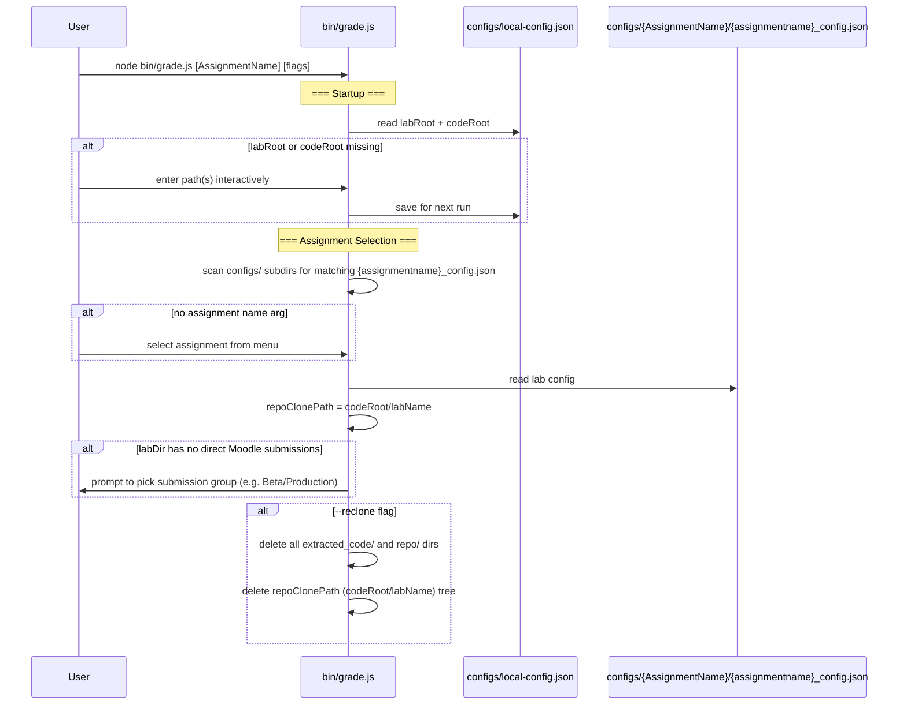
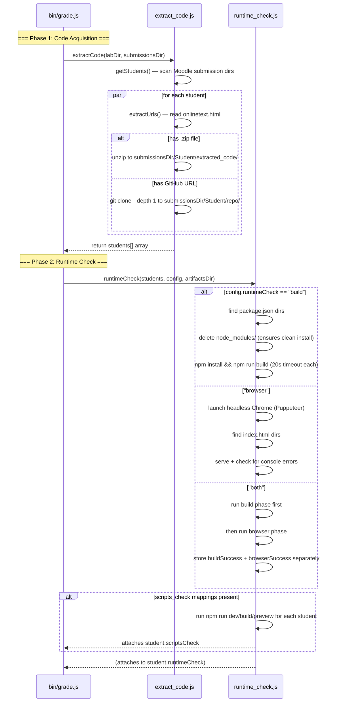
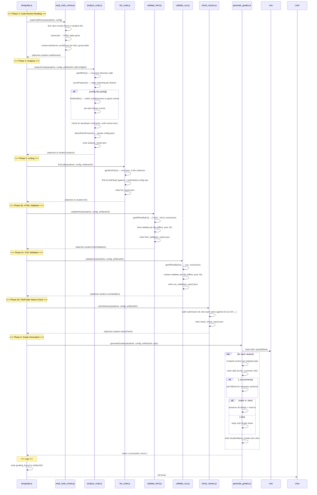
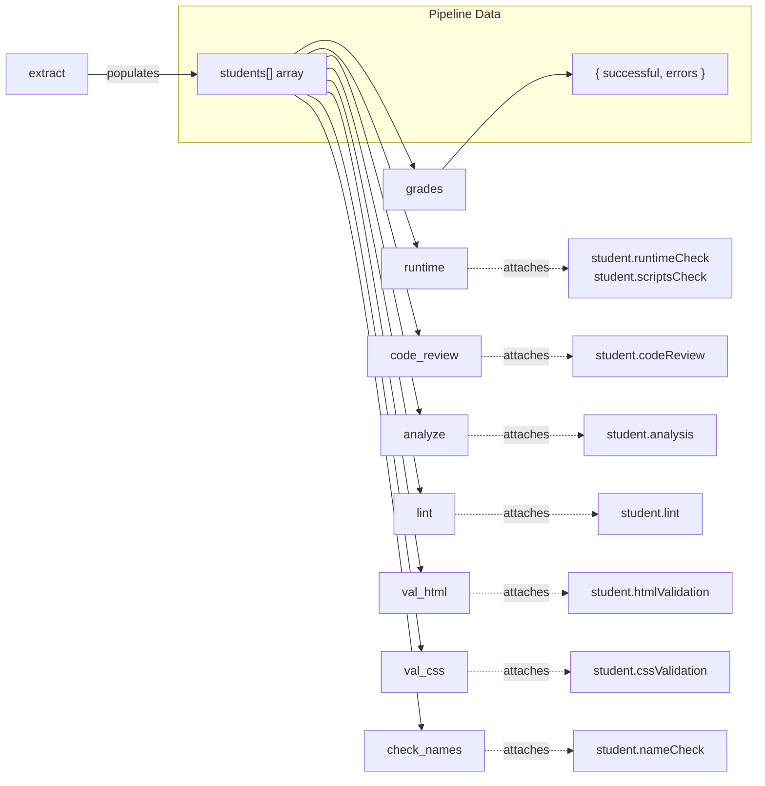

# CS233JS AI Grader — Developer Guide


[TOC]


---

## Module Dependency Diagram

```mermaid
graph TD
    subgraph "Entry Points"
        grade[bin/grade.js]
        rubric_to_md[bin/rubric-to-md.js]
        configure_lab[bin/configure-lab.js]
    end

    subgraph "Pipeline Modules"
        extract[extract_code.js]
        runtime[runtime_check.js]
        code_review[read_code_review.js]
        analyze[analyze_code.js]
        lint[lint_code.js]
        val_html[validate_html.js]
        val_css[validate_css.js]
        check_names[check_names.js]
        grades[generate_grades.js]
    end

    subgraph "Supporting Modules"
        ollama[ollama_comments.js]
        file_walker[file_walker.js]
        lab_config[lab_config.js]
        llm_client[llm_client.js]
        tui[tui.js]
        config_prompts[config_prompts.js]
    end

    subgraph "External Dependencies"
        puppeteer
        xlsx_npm[xlsx npm package]
        eslint
        html_validate[html-validate]
        csstree[csstree-validator]
    end

    subgraph "Configuration"
        local_config[configs/local-config.json]
        lab_configs[configs/{AssignmentName}/{assignmentname}_config.json]
        eslint_config[eslint/student.eslint.config.mjs]
    end

    %% Entry → Pipeline
    grade --> extract
    grade --> runtime
    grade --> code_review
    grade --> analyze
    grade --> lint
    grade --> val_html
    grade --> val_css
    grade --> check_names
    grade --> grades

    %% Config loading
    grade -.-> local_config
    grade -.-> lab_configs

    %% Module internal deps
    grades --> ollama
    val_html --> file_walker
    val_css --> file_walker
    check_names --> file_walker
    lint --> file_walker
    analyze --> file_walker
    configure_lab --> tui
    configure_lab --> lab_config
    configure_lab --> llm_client
    configure_lab --> config_prompts
    config_prompts --> lab_config

    %% External deps
    runtime --> puppeteer
    grades --> xlsx_npm
    lint --> eslint
    lint -.-> eslint_config
    val_html --> html_validate
    val_css --> csstree

    %% Data flow direction (for readability)
    extract --> analyze
    analyze --> grades
    runtime --> grades
    lint --> grades
    val_html --> grades
    val_css --> grades
    check_names --> grades

    style grade fill:#4a90d9,color:#fff
    style rubric_to_md fill:#4a90d9,color:#fff
    style configure_lab fill:#4a90d9,color:#fff
    style extract fill:#50b86c,color:#fff
    style runtime fill:#50b86c,color:#fff
    style code_review fill:#50b86c,color:#fff
    style analyze fill:#50b86c,color:#fff
    style lint fill:#50b86c,color:#fff
    style val_html fill:#50b86c,color:#fff
    style val_css fill:#50b86c,color:#fff
    style check_names fill:#50b86c,color:#fff
    style grades fill:#50b86c,color:#fff
```

---

## Startup & Configuration Flow



## Pipeline Phases 1–2: Code Acquisition & Runtime Check



## Pipeline Phases 3–6: Analysis, Validation & Grading



---

## File-by-File Reference

### `bin/grade.js` — Master Orchestrator

The entry point. Handles CLI argument parsing, interactive menus, env configuration, and orchestrates all pipeline phases.

**Key behaviors:**
- Reads `labRoot` and `codeRoot` from `AI_Grading/configs/local-config.json` (prompts & saves if missing; tries `default-config.json` as fallback for new machines; migrates from old `env.json` automatically)
- Scans `configs/` for subdirectories containing a matching `{assignmentname}_config.json` to build the assignment menu
- Computes `submissionsDir = <codeRoot>/<labName>/SubmissionsAndAssessment` and `artifactsDir = <codeRoot>/<labName>/Artifacts`
- `--reclone` wipes both old-style dirs (inside submission folders) and the `<codeRoot>/<labName>` tree
- `--regrade` without `--reclone` runs `git pull` on each student's existing repo before re-grading
- When `labDir` has no direct Moodle submissions but contains subdirs that do (e.g. separate Beta/Production groups), prompts the user to pick which group to grade
- Validates config on startup — checks required keys, known mapping types, cell reference format, part structure, feature definitions
- In **normal mode**, filters out students whose grade output already exists before passing the array to any pipeline phase — only new students are processed
- Each phase attaches data directly to the shared `students` array; `generate_grades` reads from the student objects
- Writes `grading_log.txt` to `artifactsDir` on completion

### `extract_code.js` — Code Acquisition

Handles extracting student code from submissions.

| Function | Purpose |
|---|---|
| `readFileWithTimeout()` | Read a file with a 10s timeout guard (protects against Google Drive blocking reads) |
| `normalizeGithubUrl()` | Normalize various GitHub URL formats to `https://github.com/owner/repo.git` |
| `getGithubSubdir()` | Extract subdirectory path from tree URLs (e.g., `/tree/main/Lab04` → `Lab04`) |
| `getStudents()` | Scan lab directory for Moodle submission folders matching `Name_ID_assignsubmission_*` |
| `extractUrls()` | Parse `onlinetext.html` for citstudent and GitHub URLs |
| `extractStudentCode()` | Unzip or git clone per student; sets `student.extractedDir` |

**Directory naming:**
- GitHub clones → `<codeRoot>/<labName>/SubmissionsAndAssessment/StudentName/repo/`
- ZIP extractions → `<codeRoot>/<labName>/SubmissionsAndAssessment/StudentName/extracted_code/`

**Git clone safety:**
- 60-second timeout with SIGKILL to prevent hangs
- `--depth 1` for shallow clones (faster)

### `runtime_check.js` — Runtime Error Detection

Three modes, controlled by `config.runtimeCheck`:

**`"build"` mode:**
- Recursively finds `package.json` files (skipping `node_modules`, hidden, and `dist` dirs)
- For each: deletes any existing `node_modules/` (prevents committed `node_modules` from having broken `.bin/` symlinks), then runs `npm install --no-fund --no-audit --ignore-scripts` then `npm run build`
- Both commands have a 20-second timeout

**`"browser"` mode:**
- Launches headless Chrome via Puppeteer
- Finds all `index.html` files (recursively)
- Serves each directory on a random port
- Tracks JS runtime exceptions and failed script/stylesheet loads
- Waits for `networkidle0` plus 2s for delayed execution

**`"both"` mode:**
- Runs the full build phase first, storing results as `buildSuccess` / `buildErrors`
- Then runs the browser phase on the built output, storing results as `browserSuccess` / `browserErrors`
- Use `build_check`, `browser_check`, or `build_and_browser_check` mapping types to score each sub-result

**Scripts check sub-phase:**
- Automatically runs when any `scripts_check` mapping is present in the config
- Verifies that the specified npm scripts (e.g. `dev`, `build`, `preview`) are defined and exit 0
- Results stored in `student.scriptsCheck`

### `read_code_review.js` — Code Review Reader

Runs **before** `analyze_code.js` so the group letter is available during analysis.

- Finds `.docx` code review forms in each student's submission folder
- Uses `mammoth` to convert the docx to HTML, then parses the table
- Extracts per-item beta and production scores, `productionCompleted` flag, and group letter (`A`/`B`/`C`)
- Attaches `student.codeReview` with `{ found, items[{betaScore, prodScore}], productionCompleted, group }`

### `analyze_code.js` — Feature Detection

Regex-based analysis of student JavaScript files.

**Key logic:**
- `getAllFiles()` — recursive directory walk (skips symlinks to prevent infinite loops from circular references)
- `countFeatures()` — counts regex matches per feature. Each feature is filtered to matching files via its `fileRegex` field (defaults to `.js` files). JS files have comments stripped before matching; other file types are searched as-is.
- `findPartDir()` — multi-pass search for part subdirectories (game name matching, folder pattern fallback)
- Checks for developer comments (name/date markers in files) and code review documents
- `detectPartsPresent()` — scans extracted directory for part subdirectories; auto-detects `part1`, `part2`, etc. even without explicit `parts` config. Results stored in `analysis.partPresence`
- **Custom analyzer hook** — `config.analysis.customAnalyzer` specifies a JS module (relative to `configs/{AssignmentName}/`) that receives `(jsFiles, analysis, config, student)` and can mutate `analysis` directly. Enables lab-specific checks beyond regex (e.g., Lab02's `modules` feature requires both `import` AND `export`)

### `lint_code.js` — ESLint Runner

Runs ESLint v9+ with flat config.

- Resolves the ruleset per-lab (a `configs/{Lab}/eslint.config.mjs` override if present, else the shipped `eslint/student.eslint.config.mjs`) and copies it into the lab folder for VS Code consistency. Uses ESLint's Node API (`new ESLint().lintFiles()`), not a shelled-out CLI.
- Collects `.js` files recursively, respecting per-lab exclusions (e.g., `node_modules`, `dist`, `part1`)
- Outputs human-readable rule descriptions (42 rules mapped)
- Writes `lint_report.json`
- Attaches `student.lint` with `{ jsFiles, errors, warnings, errorMessages, warningMessages, messages }`

### `validate_html.js` — HTML Validator

Validates HTML files using `html-validate` (pure JS, fully offline — no network calls).

- Collects `.html` and `.htm` files via `getAllFilesByExt`, respecting `config.validate.exclude`
- Runs `html-validate` with `html-validate:recommended` preset by default; `no-trailing-whitespace` is disabled (cosmetic, not a validity issue)
- Ruleset can be overridden per-lab via `config.validate.htmlExtends` (preset list) and `config.validate.htmlRules` (per-rule overrides)
- Aggregates results: error count, warning count, per-rule counts, top-N issue list
- Attaches `student.htmlValidation` with `{ htmlFiles, errors, warnings, messages, ruleCounts }`
- Writes `html_validation_report.json`

### `validate_css.js` — CSS Validator

Validates CSS files using `csstree-validator` (pure JS, fully offline).

- Collects `.css` files via `getAllFilesByExt`, respecting `config.validate.exclude`
- Reports parse/syntax errors only — no warning tier (csstree doesn't have one)
- Error names (e.g. `SyntaxReferenceError`, `SyntaxMatchError`) used as rule IDs in aggregation
- Attaches `student.cssValidation` with `{ cssFiles, errors, warnings: 0, messages, ruleCounts }`
- Writes `css_validation_report.json`

### `check_names.js` — File/Folder Name Checker

Checks every file and folder name in each student's submission for Linux/web portability.

- **Rule:** name is invalid if it contains any character outside `[A-Za-z0-9._-]`, starts with `-`, or exceeds 255 bytes. Spaces are called out distinctly. Uppercase is allowed; dotfiles (`.gitignore`) pass.
- Walks the submission tree with `walk()`, skipping `DEFAULT_SKIP_DIRS` and dot-directories
- `config.nameCheck.extraAllowed` adds extra allowed characters (e.g. `+` for certain frameworks)
- `config.validate.exclude` exclusion list also applies here
- Attaches `student.nameCheck` with `{ entriesChecked, errors, messages, badNames }`
- Writes `name_check_report.json`

### `generate_grades.js` — Rubric Spreadsheet Filler

Reads the rubric template and writes per-student graded spreadsheets.

**Handler registry:** Mapping types are registered via `registerHandler(type, fn)`. External modules can add new types without editing this file. The exported `VALID_MAPPING_TYPES` Set is built dynamically from the registry (imported by `bin/grade.js` for config validation).

**Cell mapping types:**

| Type | Auto-grades? | Behavior |
|---|---|---|
| `feature` | Yes | Score based on feature count vs. `minCount` |
| `part1_completed` | Yes | Score if Part 1 files exist (reads `analysis.partPresence.part1`) |
| `part_completed` | Yes | Generic version — checks `analysis.partPresence[partId]` |
| `apps_in_repo` | Yes | Score if all parts found in GitHub repo |
| `developer_comments` | Yes | Score if name/date markers found |
| `code_review` | Yes | Full/half/zero based on review found + production column complete |
| `url_check` | Partial | Writes URL for manual verification; score left blank |
| `deploy_check` | Partial | Fetches citstudent URL; scores reachability + bundling; flags transient failures for manual review |
| `lint` | Yes | Score based on ESLint issue count. Optional `severity: "errors"` (binary pass/fail) or `"warnings"` (graduated). Default uses combined total. |
| `html_validate` | Yes | Score based on HTML error count; `tolerance` (default 3) sets half-point tier |
| `css_validate` | Yes | Score based on CSS error count; `tolerance` (default 3) sets half-point tier |
| `name_check` | Yes | Score based on invalid name count; `tolerance` (default 2) sets half-point tier |
| `build_check` | Yes | Score based on build success (from `"build"` or `"both"` mode) |
| `browser_check` | Yes | Score based on browser console errors (from `"browser"` or `"both"` mode) |
| `build_and_browser_check` | Yes | Full/half/zero based on both build and browser results combined |
| `scripts_check` | Yes | Proportional score: how many of the specified npm scripts pass |
| `manual` | No | Reads production/beta score from code review form; falls back to "NEEDS MANUAL CHECK" |
| `part_feature` | Yes | Per-part feature check — reads `analysis.partFeatures[partId][featureId]` |
| `repo_hygiene` | Yes | Score if no excluded folders (e.g. `node_modules`, `dist`) are committed to the repo |
| `github_repo` | Yes | Score if a GitHub URL was provided and the repo was successfully cloned |
| `collaborator_check` | Yes | Score if GitHub repo was cloned (proxy for instructor being added as collaborator) |
| `gitignore_check` | Yes | Score if `.gitignore` file exists in the repo root |
| `npm_package` | Yes | Score if any qualifying npm packages are imported (uses `analysis.npmPackages`) |
| `package_check` | Yes | Score if `package.json` contains the expected `dependencies` and `devDependencies` |

**`stockComments`:** Any mapping may include `stockComments: { full, partial, zero }` — short strings written into the comment cell instead of the verbose auto-generated comment. Handlers that set `keepComment: true` (e.g. `deploy_check` manual-review flags, validation errors) are **not** overridden by `stockComments.zero`, so diagnostics are never silently erased.

**Per-part feature pipeline:** `featureCounts` entries in `config.parts[].featureCounts` are converted to `part_feature`-type virtual mappings and processed through the same handler pipeline. This means per-part and top-level scoring share the same logic; no separate code path is needed.

**Macro/button preservation (`.xlsm` only):** SheetJS strips drawing objects and VBA data when re-writing. After SheetJS writes the output file, `adm-zip` is used to: (1) copy drawing XML, VML, and control-property ZIP entries from the template; (2) patch the Grade sheet XML to re-inject `<drawing>` / `<legacyDrawing>` / `<controls>` elements and any missing namespace declarations; (3) re-add all non-Grade sheets as `state="veryHidden"` — required because the VBA binary references every original sheet module by code name, and Excel refuses to load the VBA project if any referenced sheet is missing. When `.xlsx`, only the `Grade` sheet is kept and no post-processing is needed.

**AI summaries:** With `--ai-comments`, calls `ollama_comments.js` to generate a one-sentence summary for `config.summaryCell`.

### `lib/file_walker.js` — Shared Directory Traversal

Used by analyze_code, lint_code, validate_html, validate_css, and check_names. Replaces several near-identical hand-rolled walkers.

**Exports:**

| Export | Purpose |
|---|---|
| `walk(dir, opts)` | Core pre-order DFS traversal. Callbacks: `visit`, `onFile`, `onDir`, `shouldSkip`, `shouldDescend`. Options: `followSymlinks` (default false), `maxDepth` (default Infinity). Unreadable dirs are silently skipped. |
| `getAllFilesByExt(dir, ext, exclusions)` | Collect all files with a given extension (or array of extensions). Skips `DEFAULT_SKIP_DIRS`, dot-directories, and any path matching an exclusion substring. |
| `DEFAULT_SKIP_DIRS` | `Set(['node_modules', 'dist', 'build', '.git', '__MACOSX'])` — dirs never scanned. |

### `lib/llm_client.js` — Unified LLM Client

Wraps Ollama, OpenRouter, and Anthropic behind a single `chat(systemPrompt, userPrompt)` interface.

- `LLMClient` — class with `chat()`, `_chatOpenAI()`, `_chatAnthropic()`, `_request()`
- `loadLLMClient(localConfigPath)` — reads `llm` block from `local-config.json`; resolves API key from environment first, then stored value
- `setupLLMInteractive(localConfigPath, driver)` — full guided provider/model/key setup; saves to `local-config.json`
- `selectModel(localConfigPath, driver)` — simplified 4-option picker used by `configure_lab.js`; shows current selection as default
- `detectOllamaModel()` — probes `localhost:11434/api/tags` for a running model name (2s timeout)
- On HTTP 429, automatically retries with `fallbackModel` if configured; otherwise retries up to 3 times with exponential backoff

### `lib/tui.js` — Terminal UI

Provides the full-screen interface for `configure_lab.js` using `neo-blessed`.

- Scrollable log pane (redirects `console.log`/`console.error` while active)
- `ask(prompt, def)` — text input bar with default; returns trimmed string
- `askBoolean(question, def)` / `askInt(prompt, def)` — typed wrappers over `ask()`
- `askOptions(prompt, opts, defIdx)` — centered popup list with arrow-key navigation; shows per-item description in a bottom bar
- `reviewTable(makeItems, editRow)` — full-screen navigable table for reviewing/editing draft mappings before accepting
- `showSpinner(msg)` / `clearSpinner()` — floating overlay for async operations

### `ollama_comments.js` — AI Summary Generator

Hits a local Ollama instance (`http://localhost:11434`) to generate one-sentence rubric summaries.

- Discovers available models via `/api/tags`
- Sends a prompt with feature counts, lint issues, and runtime results
- Requests a 20-word-max sentence at `temperature: 0`
- Retries up to 3 times with exponential backoff (1s, 2s, 4s) to handle cold-start delays
- Returns `null` if all retries fail — caller falls back to placeholder text

### `rubric_to_md.js` — Standalone Utility

Dumps a rubric spreadsheet's Grade sheet as Markdown. Not part of the grading pipeline.

Usage: `node bin/rubric_to_md.js path/to/Rubric.xlsm [output.md]`

### `configure_lab.js` — Assignment Configuration Wizard

Interactive CLI tool to create a new lab or assignment configuration from scratch. Not part of the grading pipeline.

Usage: `node bin/configure_lab.js [AssignmentName]`

**Key functions (testable via `lib/lab_config.js` and `lib/config_prompts.js`):**
| Function | Module | Purpose |
|---|---|---|
| `normalizeAssignmentName(input)` | `lab_config.js` | Digits-only → `"Lab07"`; `Lab`-prefixed → normalized `"Lab07"`; other slug (e.g. `"TermProject"`) → returned as-is |
| `colLetter(idx)` / `excelCell(col, row)` | `lab_config.js` | Build Excel cell references (e.g., `"C7"`) |
| `readRubricRows(path, labelOrLayout?)` | `lab_config.js` | Reads the Grade sheet from a rubric via xlsx, returns structured row objects |
| `buildConfig(labName, responses)` | `lab_config.js` | Assembles a `{assignmentname}_config.json` object from wizard responses |
| `buildMappingEntry(driver, type, rubricRow)` | `config_prompts.js` | Creates a single mapping entry with type-specific fields |
| `copyRubric(driver, labName)` | `config_prompts.js` | Prompts for a rubric file path, suggests canonical name, returns `{ rubricPath, rubricName, ext }` |

**Input mechanism:** Uses a `driver` abstraction (`{ ask, askBoolean, askInt, askOptions, print, exit }`) so the wizard logic is testable independently of the TUI. The TUI implementation lives in `configure_lab.js`; tests use a `mockDriver` factory in `test/configure_lab.spec.mjs`.

Tests live in `test/configure_lab.spec.mjs`.

---

## Configuration Reference

### `configs/local-config.json`

```json
{
  "labRoot": "/path/to/StudentLabWork",
  "codeRoot": "/path/to/local/GradingCode"
}
```

Machine-specific. Gitignored. Created on first run. Both paths are prompted for interactively if missing. On startup, `local-config.json` is tried first; `default-config.json` (shipped with the repo) is tried second; the old `env.json` is tried last as a migration path.

| Field | Description |
|---|---|
| `labRoot` | The Google Drive folder containing all lab directories (e.g., `StudentLabWork`) |
| `codeRoot` | A local folder **outside** Google Drive where student code is cloned/unzipped. The grader creates `<labName>/SubmissionsAndAssessment/` and `<labName>/Artifacts/` inside it automatically |

### `configs/{AssignmentName}/{assignmentname}_config.json` schema

```json
{
  "rubricName": "CS233JS_{AssignmentName}_Rubric.xlsx",
  "titleCell": "A1",
  "titleText": "Lab X: Title",
  "summaryCell": "A2",
  "graderCell": "G1",
  "runtimeCheck": "build" | "browser" | "both",
  "codeReview": {
    "studentNameCell": "B1",
    "groupCell": "C1",
    "manualFallback": "maxScore" | "zero" | "skip"
  },
  "lint": {
    "exclude": ["node_modules", "dist"]
  },
  "validate": {
    "exclude": ["node_modules", "dist"],
    "htmlExtends": ["html-validate:recommended"],
    "htmlRules": { "no-inline-style": "error" }
  },
  "nameCheck": {
    "extraAllowed": "+"
  },
  "repoHygiene": {
    "excludedFromRepo": ["node_modules", "dist"]
  },
  "packageCheck": {
    "dependencies": ["vite"],
    "devDependencies": [],
    "allowedExtras": ["eslint"]
  },
  "analysis": {
    "features": [
      {
        "id": "counted_feature",
        "regex": "fetch\\s*\\(",
        "fileRegex": "\\.js$"
      },
      {
        "id": "boolean_feature",
        "match": { "anyOf": [ { "regex": "=>" }, { "regex": "localStorage" } ] },
        "fileRegex": "\\.js$"
      }
    ]
  },
  "parts": [
    {
      "id": "part1",
      "gameNames": ["domino", "boston", "boneyard"],
      "folderPattern": "(?:part|pt)\\s*[_-]?\\s*1",
      "featureCounts": [
        { "featureId": "classes", "minCount": 1, "cell": "C8", "commentCell": "E8", "maxScore": 5 }
      ]
    }
  ],
  "mappings": [
    {
      "cell": "C10",
      "commentCell": "E10",
      "type": "feature",
      "featureId": "modules",
      "maxScore": 6,
      "stockComments": { "full": "Good", "partial": "Partial", "zero": "Missing" }
    },
    {
      "cell": "C12",
      "commentCell": "E12",
      "type": "html_validate",
      "maxScore": 4,
      "tolerance": 0
    },
    {
      "cell": "C13",
      "commentCell": "E13",
      "type": "scripts_check",
      "maxScore": 3,
      "scripts": ["dev", "build", "preview"]
    }
  ]
}
```

| Field | Required | Description |
|---|---|---|
| `rubricName` | Yes | Filename of the rubric spreadsheet in `configs/{AssignmentName}/` |
| `titleCell` / `titleText` | No | Cell and text for the lab title |
| `summaryCell` | No | Cell for AI-generated or manual summary comment |
| `graderCell` | No | Cell written with "Computer"; triggers versioned copy on regrade if changed |
| `runtimeCheck` | Yes | `"build"`, `"browser"`, or `"both"` |
| `codeReview` | No | Cell refs for student name and group letter in rubric |
| `lint.exclude` | No | Path substrings to skip during linting |
| `validate.exclude` | No | Path substrings to skip during HTML/CSS validation and name checks |
| `validate.htmlExtends` | No | Override html-validate preset list |
| `validate.htmlRules` | No | Per-rule overrides for html-validate |
| `nameCheck.extraAllowed` | No | Extra characters allowed in file/folder names |
| `repoHygiene.excludedFromRepo` | No | Folder names that should not be committed to the repo |
| `packageCheck` | No | Expected npm package sections; `allowedExtras` whitelists student-added packages |
| `analysis.features` | Yes | Array of features to detect. Each is counted (`regex`) or boolean (`match`: nested `allOf`/`anyOf`/`regex`) |
| `analysis.customAnalyzer` | No | **DEPRECATED** (use a `match` feature instead). Filename in `src/analyzers/` of a last-resort custom module; none currently exist |
| `parts` | No | Multi-part lab configuration |
| `mappings` | Yes | Array of rubric cell assignments |

## Adding a New Lab

### Using the interactive wizard (recommended)

```bash
node bin/configure-lab.js               # fully interactive, prompts for assignment name
node bin/configure-lab.js Lab07         # pre-specify a lab by number or name
node bin/configure-lab.js TermProject   # pre-specify a non-numbered assignment
```

The wizard guides you through:
1. Copying a rubric spreadsheet into `configs/{AssignmentName}/`
2. Configuring the title, runtime check mode, feature rules, and rubric cell mappings

Choose between two mapping modes:
- **cell-by-cell wizard** — reads the rubric Grade sheet via xlsx, displays each row with auto-derived cell references, and lets you assign mapping types row by row
- **simplified checklist** — yes/no for each of the common mapping types (feature, manual, lint, code_review, html_validate, etc.), prompting for cell references and scores

### Manual setup

1. Create `configs/{AssignmentName}/` (e.g., `configs/Lab05/` or `configs/TermProject/`)
2. Create `configs/{AssignmentName}/{assignmentname}_config.json` following the schema above
3. Copy the rubric spreadsheet (`CS233JS_{AssignmentName}_Rubric.xlsx` or `.xlsm`) into `configs/{AssignmentName}/`
4. ESLint ruleset comes from the shipped `eslint/student.eslint.config.mjs`; add `configs/{AssignmentName}/eslint.config.mjs` only to override it for that lab — no per-assignment config needed otherwise.
5. For a check that needs more than counting one regex, use a nested `match` (allOf/anyOf) feature in the config — **not** a custom analyzer (deprecated; see schema notes).
6. Run `node bin/grade.js` (or `cs233-grade`) — the new assignment appears in the menu automatically.

## Data Flow



Each phase attaches its results directly to each student object. After extraction, students carry `filesDir`, `extractedDir`, `urls`. Subsequent phases attach `student.runtimeCheck` / `student.scriptsCheck`, `student.codeReview`, `student.analysis`, `student.lint`, `student.htmlValidation`, `student.cssValidation`, and `student.nameCheck`. The grade generator reads all data from the student objects — no name-based joins needed.

## Google Drive Considerations

The lab directories live on Google Drive, which uses on-demand file syncing. This causes two issues:

1. **File reads can block** — `fs.readFileSync()` on an unsynced file hangs while Google Drive downloads it. Mitigated by `readFileWithTimeout()` in `extract_code.js` and the `codeRoot` setting that moves code off the cloud drive.

2. **Recursive directory walks can hang** — walking a directory tree on Google Drive triggers sync for each directory entry. Mitigated by skipping symlinks (`fs.lstatSync` instead of `fs.statSync`) and excluding `node_modules`, `dist`, and hidden directories.

3. **Git operations on Google Drive** — `git clone` writing to a Google Drive path can stall. All code extraction uses `codeRoot` which should point to a local (non-cloud) filesystem.

## Continuous Integration

CI runs in GitHub Actions via `.github/workflows/ci.yml` (workflow name **CI**). It triggers on **push to `main`** and on **every pull request**, so the suite runs both while a PR is open and again on the merge commit.

Two jobs:

| Job | Runs on | Node | Command |
|---|---|---|---|
| `test` | **ubuntu-latest, windows-latest, macos-latest** (matrix, `fail-fast: false`) | 22 | `npm ci` → `npm test` |
| `lint` | ubuntu-latest (OS-independent, so once) | 22 | `npm ci` → `npm run lint` (`eslint .`) |

- The matrix runs all three OSes even if one fails, so a Windows-only break is visible alongside passing Linux/macOS runs — important because the pipeline does a lot of path handling.
- `PUPPETEER_SKIP_DOWNLOAD: "true"` is set workflow-wide: the unit tests don't launch a browser, so skipping Chromium's download keeps installs fast and avoids network flakiness.
- **Local mirror:** the `prepare` npm script points `core.hooksPath` at `githooks/`, whose `pre-commit` hook runs `npm test` before every commit — so test failures are caught locally before they ever reach CI. (The hook does not run lint; the `lint` CI job is the gate for that.)

A green merge to `main` therefore means: tests pass on all three OSes **and** `eslint .` is clean.
