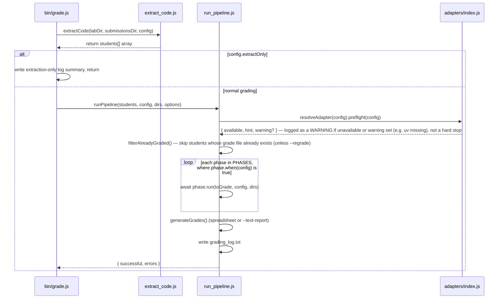
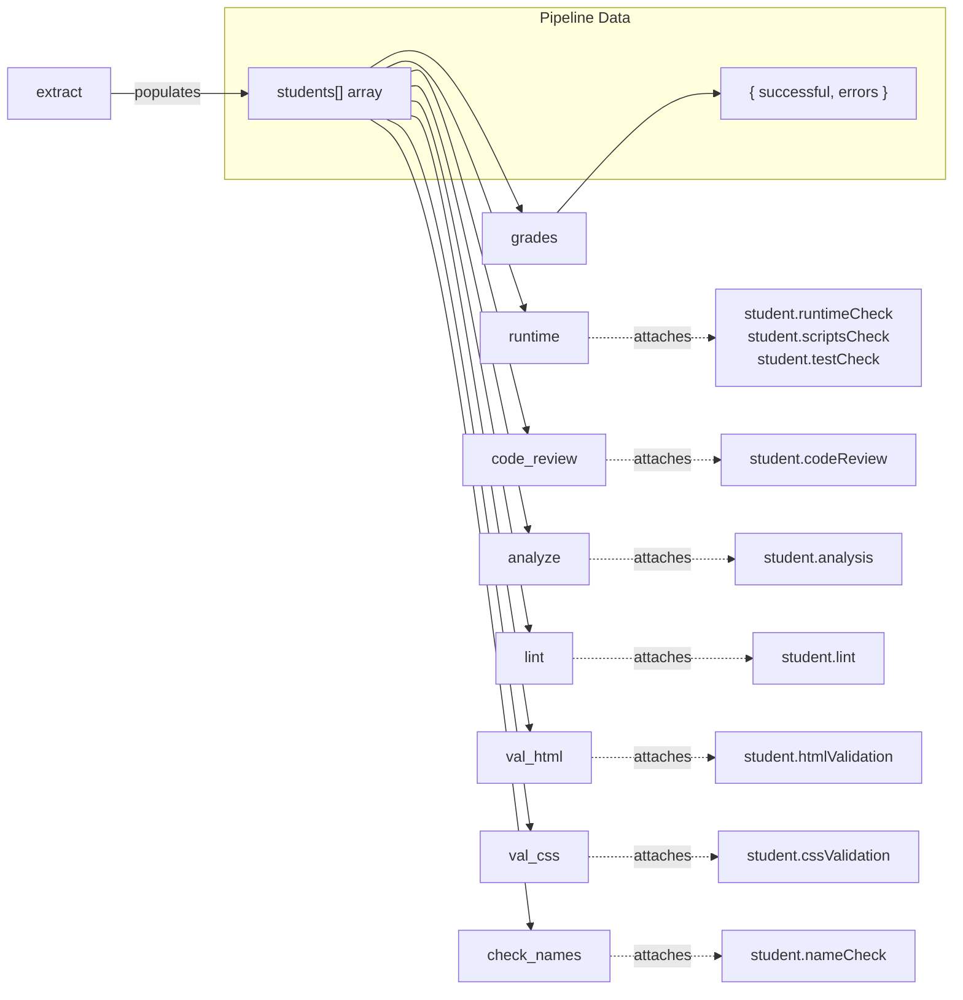

# CS233JS AI Grader — Developer Guide


[TOC]


---

## Module Dependency Diagram

```mermaid
graph TD
    subgraph "Entry Points"
        grade[bin/grade.js]
        rubric_to_md[bin/rubric-to-md.js]
        configure_lab[bin/configure-lab.js]
    end

    subgraph "Orchestrator"
        run_pipeline[run_pipeline.js]
    end

    subgraph "Pipeline Modules"
        extract[extract_code.js]
        extract_canvas[extract_code_canvas.js]
        runtime[runtime_check.js]
        code_review[read_code_review.js]
        analyze[analyze_code.js]
        lint[lint_code.js]
        val_html[validate_html.js]
        val_css[validate_css.js]
        check_names[check_names.js]
        grades[generate_grades.js]
    end

    subgraph "Language Adapters"
        adapter_index[adapters/index.js]
        adapter_js[adapters/javascript.js]
        adapter_ts[adapters/typescript.js]
        adapter_py[adapters/python.js]
        adapter_cpp[adapters/cpp.js]
        adapter_cs[adapters/csharp.js]
    end

    subgraph "Supporting Modules"
        ollama[ollama_comments.js]
        file_walker[file_walker.js]
        handler_registry[handler_registry.js]
        config_validation[config_validation.js]
        sandbox[sandbox.js]
        lab_config[lab_config.js]
        llm_client[llm_client.js]
        tui[tui.js]
        config_prompts[config_prompts.js]
        variation_detect[variation_detect.js]
        student_group[student_group.js]
        merge_config[merge_config.js]
        canvas_client[canvas_client.js]
    end

    subgraph "External Dependencies"
        puppeteer
        xlsx_npm[xlsx npm package]
        eslint
        html_validate[html-validate]
        csstree[csstree-validator]
    end

    subgraph "Configuration"
        local_config[configs/local-config.json]
        lab_configs[configs/{Course}/{AssignmentName}/{assignmentname}_config.json]
        eslint_config[eslint/student.eslint.config.mjs]
    end

    %% Entry → Orchestrator → Pipeline
    grade --> extract
    grade -.->|--canvas, or config.canvas.assignmentId| extract_canvas
    extract_canvas --> canvas_client
    extract_canvas -.->|reuses acquireCode/matchUrlCategories| extract
    grade --> run_pipeline
    run_pipeline --> runtime
    run_pipeline --> code_review
    run_pipeline --> analyze
    run_pipeline --> lint
    run_pipeline --> val_html
    run_pipeline --> val_css
    run_pipeline --> check_names
    run_pipeline --> grades

    %% Config loading
    grade -.-> local_config
    grade -.-> lab_configs
    grade -.->|validateConfig, loadHandlerModules| config_validation
    config_validation -.->|handlerModules, before validateConfig| handler_registry

    %% Adapter resolution — every language-specific phase resolves an adapter by config.language
    runtime --> adapter_index
    analyze --> adapter_index
    lint --> adapter_index
    run_pipeline --> adapter_index
    adapter_index --> adapter_js
    adapter_index --> adapter_ts
    adapter_index --> adapter_py
    adapter_index --> adapter_cpp
    adapter_index --> adapter_cs
    adapter_ts -.->|extends| adapter_js

    %% Module internal deps
    grades --> ollama
    grades --> handler_registry
    val_html --> file_walker
    val_css --> file_walker
    check_names --> file_walker
    lint --> file_walker
    analyze --> file_walker
    analyze --> variation_detect
    run_pipeline --> student_group
    student_group --> variation_detect
    student_group --> merge_config
    runtime --> student_group
    analyze --> student_group
    grades --> student_group
    lab_config --> merge_config
    config_validation --> merge_config
    runtime --> sandbox
    adapter_py -->|runTests through the chokepoint| sandbox
    configure_lab --> tui
    configure_lab --> lab_config
    configure_lab --> llm_client
    configure_lab --> config_prompts
    config_prompts --> lab_config

    %% External deps (JS adapter only — other adapters shell out to their own toolchains)
    runtime --> puppeteer
    grades --> xlsx_npm
    adapter_js --> eslint
    adapter_js -.-> eslint_config
    val_html --> html_validate
    val_css --> csstree

    %% Data flow direction (for readability)
    extract --> analyze
    analyze --> grades
    runtime --> grades
    lint --> grades
    val_html --> grades
    val_css --> grades
    check_names --> grades

    style grade fill:#4a90d9,color:#fff
    style rubric_to_md fill:#4a90d9,color:#fff
    style configure_lab fill:#4a90d9,color:#fff
    style run_pipeline fill:#d98c4a,color:#fff
    style extract fill:#50b86c,color:#fff
    style extract_canvas fill:#50b86c,color:#fff
    style runtime fill:#50b86c,color:#fff
    style code_review fill:#50b86c,color:#fff
    style analyze fill:#50b86c,color:#fff
    style lint fill:#50b86c,color:#fff
    style val_html fill:#50b86c,color:#fff
    style val_css fill:#50b86c,color:#fff
    style check_names fill:#50b86c,color:#fff
    style grades fill:#50b86c,color:#fff
    style adapter_index fill:#9b59b6,color:#fff
    style adapter_js fill:#9b59b6,color:#fff
    style adapter_ts fill:#9b59b6,color:#fff
    style adapter_py fill:#9b59b6,color:#fff
    style adapter_cpp fill:#9b59b6,color:#fff
    style adapter_cs fill:#9b59b6,color:#fff
```

`bin/grade.js` performs code acquisition (`extract_code.js`) and the `extractOnly` short-circuit directly, then hands the extracted `students[]` array to `run_pipeline.js`'s `runPipeline()`, which runs the remaining phases (a data-driven list, not a hardcoded sequence — see "Pipeline Orchestration" below) plus grade generation and the log summary. Every phase that used to hardcode JS/npm/ESLint logic now resolves a **language adapter** (`src/adapters/`, keyed by `config.language`, default `"javascript"`) and delegates the language-specific mechanics to it.

Everything above (and this doc) is written CS233JS-first for historical reasons, but the tool
now supports grading multiple **courses** across multiple **terms** — every config/data path
is scoped under `configs/{Course}/…`, and `labRoot`/`codeRoot` are resolved per named term
(e.g. "Spring 2026") rather than a single fixed pair (see "Startup & Configuration Flow" and
"Configuration Reference" below). With one course and one term configured, the plain
interactive menu still shows both pickers (so the selection UI is discoverable), but any
shortcut invocation (`node bin/grade.js Lab03`) auto-resolves them silently — it only becomes
unavoidable to choose once a second course or term is added.

---

## Startup & Configuration Flow

```mermaid
sequenceDiagram
    participant User
    participant grade as bin/grade.js
    participant lc as configs/local-config.json
    participant config as configs/{Course}/{AssignmentName}/{assignmentname}_config.json

    User->>grade: node bin/grade.js [CourseName] [AssignmentName] [flags]

    Note over grade: isPlainMenu = true only when NO positional args were given at all

    Note over grade: === Course Selection ===
    grade->>grade: getExistingCourses(configs/) — subdirs with course_config.json or any assignment config
    alt exactly one course AND NOT isPlainMenu (a shortcut, e.g. "grade.js Lab03")
        grade->>grade: auto-select it silently — positional args unchanged
    else isPlainMenu, or 2+ courses
        Note over grade: with 2+ courses, position 0 of the CLI args is always the course
        alt no course arg / no match / isPlainMenu
            User->>grade: select course from menu (always shown in the plain menu, even with 1 option)
        end
    end

    Note over grade: === Term Selection ===
    grade->>lc: migrateLocalConfigTerms() — one-time: old flat labRoot/codeRoot -> terms["2026Spring"]
    alt zero terms yet
        User->>grade: create a term (label, id, labRoot, codeRoot) — same prompts the old first-run flow had
        grade->>lc: save into terms map
    else exactly one term AND NOT isPlainMenu
        grade->>grade: auto-select it silently
    else isPlainMenu, or 2+ terms
        User->>grade: select term from menu (always shown in the plain menu; "Add new term" option too)
    end
    grade->>grade: labRoot, codeRoot = selected term's values

    Note over grade: === Assignment Selection ===
    grade->>grade: scan configs/{Course}/ subdirs for matching {assignmentname}_config.json

    alt no assignment name arg
        alt course has no assignment configs yet
            grade-->>User: SetupError — "has no assignments configured yet; run configure-lab.js"
        end
        User->>grade: select assignment from menu
    end

    grade->>config: read lab config
    grade->>grade: applyCourseDefaults(config, course_config.json) — course "defaults" under the lab config (lab wins; in memory only)
    grade->>grade: merge local-config toolchains, loadHandlerModules(), validateConfig()
    grade->>grade: repoClonePath = codeRoot/courseName/labName

    alt labDir has no direct Moodle submissions
        grade->>User: prompt to pick submission group (e.g. Beta/Production)
    end

    alt --reclone flag
        grade->>grade: delete all extracted_code/ and repo/ dirs
        grade->>grade: delete repoClonePath (codeRoot/courseName/labName) tree
    end
```

## Pipeline Orchestration: run_pipeline.js

`bin/grade.js` calls `extractCode()` directly, handles the `extractOnly` short-circuit, then
calls `runPipeline(students, config, dirs, options)`. The phase list is data — an array of
`{ name, run, when }` entries (`PHASES` in `run_pipeline.js`) — rather than a hardcoded
sequence of awaits, so a future per-language config key can gate a phase (e.g. skip HTML/CSS
validation for a non-web language) without touching the loop.



## Pipeline Phases 1–2: Code Acquisition & Runtime Check

```mermaid
sequenceDiagram
    participant grade as bin/grade.js
    participant extract as extract_code.js
    participant pipeline as run_pipeline.js
    participant runtime as runtime_check.js
    participant adapter as resolved language adapter

    Note over grade: === Phase 1: Code Acquisition ===
    grade->>extract: extractCode(labDir, submissionsDir, config)
    extract->>extract: getStudents() — scan Moodle submission dirs
    par for each student
        extract->>extract: extractUrls() — categorize URLs per config.urlPatterns (default: github, citstudent)
        alt has GitHub URL
            extract->>extract: git clone --depth 1 to submissionsDir/Student/repo/ (zip only as fallback if the clone fails)
        else has .zip file
            extract->>extract: unzip to submissionsDir/Student/extracted_code/, then merge loose uploaded files (zip wins name collisions)
        else only loose files uploaded
            extract->>extract: copyLooseFiles() — top-level files minus hidden/.zip/.doc(x) into extracted_code/
        end
    end
    extract-->>grade: return students[] array

    Note over pipeline: === Phase: Runtime Check (registerCheckStrategy) — runs after readCodeReview + resolveGroups ===
    pipeline->>runtime: runtimeCheck(students, config, artifactsDir, labConfigDir)
    runtime->>runtime: strategy = getCheckStrategy(config.runtimeCheck || "build")
    runtime->>runtime: per student: configForStudent(config, student) — the group's overrides merged in; group unknown + run settings overridden → skip, groupUnknown: true
    alt strategy == "build"
        runtime->>adapter: detectProject(dir, config) → Project[]
        runtime->>adapter: install(project, config), then build(project, config)
    else "browser"
        runtime->>runtime: launch headless Chrome (Puppeteer) — generic, not adapter-specific
        runtime->>runtime: find index.html dirs, serve + check for console errors
    else "both"
        runtime->>adapter: build phase first (as above)
        runtime->>runtime: then browser phase on the built dist/
        runtime->>runtime: store buildSuccess + browserSuccess separately
    else "run_check"
        runtime->>runtime: runCheck a list? → once per run {id, entry, stdin, …}, results in runs[id], success = all runs passed
        runtime->>adapter: detectProject() — entryError → "NEEDS MANUAL CHECK: …" (entry may be a list of candidate names)
        runtime->>adapter: install(project, config) — e.g. Python uv env (cached); sets project.runCommand's interpreter
        runtime->>adapter: build (if no runCommand), then execute the artifact
        runtime->>runtime: execOptionsFor() — execution.cwd "copy" → cwdSource = project.dir; supportFiles resolved against labConfigDir
        runtime->>runtime: (sandbox) runStudentArtifact() — see sandbox.js below
        runtime->>runtime: match stdout against config.runCheck.expectPatterns
    end
    alt scripts_check mappings present
        runtime->>adapter: runScript(project, name) per configured script (adapter-delegated; null for languages with no named-script concept)
        runtime-->>pipeline: attaches student.scriptsCheck
    end
    alt test_check mappings present
        runtime->>adapter: install(project, config), then runTests(project, config, execOptions) — through the sandbox (Python: pytest or testCheck.mode "script"; C#: dotnet test)
        runtime-->>pipeline: attaches student.testCheck
    end
    runtime-->>pipeline: (attaches to student.runtimeCheck)
```

### `src/lib/sandbox.js` — Native Code Execution Isolation

The `run_check` strategy and the Python adapter's `runTests` never spawn student code
directly — they call `runStudentArtifact(argv, execConfig)`, the single isolation chokepoint
every current and future build/run/test strategy must go through.

- **`"direct"` mode** (implemented, the default): spawns the artifact from a **fresh,
  throwaway temp working directory** (so relative-path file writes/deletes the student
  program makes land somewhere disposable, not the real submission tree), with a
  timeout + kill-tree (`taskkill /T /F` on Windows, negative-PID `SIGKILL` on POSIX —
  the same pattern already used for npm script execution). This is **not a security
  sandbox** — it protects against accidental damage (infinite loops, runaway child
  processes) from bugs in trusted-classroom submissions, not deliberately malicious code.
- **`"restricted-user"`** and **`"container"`** are documented, loud-failing stubs — requesting
  either throws `execution.mode "..." is not implemented` rather than silently falling back
  to `"direct"`. `"container"` (Docker/Podman) is the real second isolation tier for when
  genuine confinement is actually needed; implement it if a future course involves
  less-trusted submissions.
- **Run directory contents:** empty by default. With `execConfig.cwdSource` (set by
  `runtime_check.js` when `config.execution.cwd === "copy"`, and always for Python tests) it
  starts as a copy of the student's project folder — `fs.cpSync` skipping `COPY_SKIP_DIRS`
  (`.venv`, `venv`, `.git`, `__pycache__`, `node_modules`, `.pytest_cache`) and all symlinks —
  so a program that opens `Data/x.csv` relative to its project folder works. `runtime_check`
  rewrites argv paths inside the project to be relative to the copy (`argvForCopy`).
  `execConfig.supportFiles` (`[{ from: absolute, to: relative }]`, from
  `config.runCheck.supportFiles` resolved against the lab's config folder) are then added
  **only where the student has no file** at that path; a missing source returns
  `{ setupError: true }` instead of running.
- **Environment:** the child gets `scrubEnv(process.env)` — the grader's environment minus
  anything matching `/(TOKEN|SECRET|PASSWORD|PASSWD|API_?KEY|ACCESS_KEY|CREDENTIALS?)$/i` or
  starting `CANVAS_` — plus `execConfig.env`. Student code can't read the grader's Canvas
  token or LLM keys.
- Configured via `config.execution: { mode, timeoutMs, cwd }` (plus `envCacheDir` /
  `installTimeoutMs`, used by the Python adapter's uv install); the file's own header comment
  is the canonical isolation-tier documentation.

## Pipeline Phases 3–6: Analysis, Validation & Grading

All of these phases are entries in `run_pipeline.js`'s `PHASES` list, invoked in order by
the loop shown in "Pipeline Orchestration" above.

```mermaid
sequenceDiagram
    participant pipeline as run_pipeline.js
    participant code_review as read_code_review.js
    participant analyze as analyze_code.js
    participant lint as lint_code.js
    participant val_html as validate_html.js
    participant val_css as validate_css.js
    participant check_names as check_names.js
    participant grades as generate_grades.js
    participant adapter as resolved language adapter

    Note over pipeline: === Phase: Code Review Reading ===
    pipeline->>code_review: readCodeReview(students, config)
    code_review->>code_review: find .docx review forms in student dirs
    code_review->>code_review: mammoth → HTML table parse
    code_review->>code_review: items[] from every Beta/Prod(/Release/Final)-headed table, each with its criterion label; group letter
    code_review-->>pipeline: (attaches student.codeReview)

    Note over pipeline: === Phase: Lab Group Resolution (student_group.js) ===
    pipeline->>pipeline: resolveGroups() — student.group = form letter (if one of config.variations), else detected from code, else unknown + reason

    Note over pipeline: === Phase: Analysis ===
    pipeline->>analyze: analyzeCode(students, config, artifactsDir, labConfigDir)
    analyze->>adapter: resolveAdapter(config) — sourceExtensions, stripComments, checkManifest, extractUsedPackages
    analyze->>analyze: getAllFiles() — recursive directory walk
    analyze->>analyze: countFeatures(files, features, adapter) — regex matching per feature, using the adapter's sourceExtensions/stripComments
    alt config has parts[]
        analyze->>analyze: findPartDir() — match subdirectories to game names
        analyze->>analyze: per-part feature counts
    end
    analyze->>analyze: checkDeveloperComments() — per-file name/date/AI-use flags from adapter.extractComments (comments only), honoring developer_comments.ignoreCommentsBy; code review docs
    analyze->>analyze: detectPartsPresent() — iterate config.parts
    analyze->>adapter: checkManifest() / extractUsedPackages() (nullable — e.g. null for C++)
    analyze->>analyze: write analysis_report.json
    analyze-->>pipeline: (attaches to student.analysis)

    Note over pipeline: === Phase: Linting ===
    pipeline->>lint: lintCode(students, config, artifactsDir, labName, stepName, courseName)
    lint->>adapter: resolveAdapter(config)
    lint->>adapter: lintConfigCandidates(configsDir, labName, parentName, courseName) — step > lab > course-wide (configs/{Course}/eslint.config.mjs or ruff.toml) > shipped default
    lint->>adapter: lint(sourceFiles, cwd, configOverride, config) → normalized diagnostics
    Note right of adapter: JS: ESLint.lintFiles(). Python: ruff --output-format json.<br/>C++/C#: compiler SARIF/MSBuild output classified error/warning.
    lint->>lint: write lint_report.json
    lint-->>pipeline: (attaches to student.lint — { sourceFiles, errors, warnings, ... })

    Note over pipeline: === Phase: HTML Validation ===
    pipeline->>val_html: validateHtml(students, config, artifactsDir)
    val_html->>val_html: getAllFilesByExt(..., ['.html', '.htm'], exclusions)
    val_html->>val_html: html-validate per file (offline, pure JS)
    val_html->>val_html: write html_validation_report.json
    val_html-->>pipeline: (attaches student.htmlValidation)

    Note over pipeline: === Phase: CSS Validation ===
    pipeline->>val_css: validateCss(students, config, artifactsDir)
    val_css->>val_css: getAllFilesByExt(..., '.css', exclusions)
    val_css->>val_css: csstree-validator per file (offline, pure JS)
    val_css->>val_css: write css_validation_report.json
    val_css-->>pipeline: (attaches student.cssValidation)

    Note over pipeline: === Phase: File/Folder Name Check ===
    pipeline->>check_names: checkNames(students, config, artifactsDir)
    check_names->>check_names: walk submission dir, test each name against [A-Za-z0-9._-]
    check_names->>check_names: write name_check_report.json
    check_names-->>pipeline: (attaches student.nameCheck)

    Note over pipeline: === Grade Generation ===
    pipeline->>grades: generateGrades(students, config, artifactsDir, opts)
    grades->>xlsx: read rubric spreadsheet
    par for each student
        grades->>grades: compute scores per mapping type (registered handlers, ../lib/handler_registry.js)
        grades->>grades: write cells (score, comment, link)
        alt --ai-comments
            grades->>grades: call Ollama for summary sentence
        end
        alt rubric is .xlsm
            grades->>grades: preserve all sheets + macros
        else .xlsx
            grades->>grades: keep only Grade sheet
        end
        grades->>grades: write StudentName_Grade.xlsx/.xlsm
    end
    grades-->>pipeline: return { successful, errors }

    Note over pipeline: === Log ===
    pipeline->>pipeline: write grading_log.txt to artifactsDir
    pipeline-->>User: All Done!
```

---

## File-by-File Reference

### `bin/grade.js` — CLI Entry Point

Handles CLI argument parsing and code acquisition, then hands off to
`src/pipeline/run_pipeline.js` for phase orchestration (see "Pipeline Orchestration"
above) — it is no longer the module that calls `runtimeCheck`/`analyzeCode`/etc. directly.
Its interactive setup phase (course/term/submission-source/assignment/step/Canvas/
rubric/mode resolution) is `src/lib/grade_setup.js`'s `resolveGradeSetup(driver, opts)` —
extracted so it's unit-testable (`test/grade_setup.spec.mjs`) against a scratch
`configs/`/labRoot/codeRoot tree and a fake driver, without spawning a real process.
`main()`'s own job is: create the driver (`createDriver()`, `src/lib/prompt_driver.js`),
call `resolveGradeSetup`, close the driver in a `finally`, replay
`driver.takeNotes()` to real stdout, then run the reclone/git-pull/extraction/pipeline
steps below using the returned setup object.

**Prompt backend:** `createDriver({ title, interactive })` picks the full-screen
neo-blessed `TUI` (`src/lib/tui.js`, the same one `configure-lab.js` uses) when both
stdin and stdout are a real TTY, or a readline fallback otherwise — so
`node bin/grade.js Lab03 --regrade > out.txt` (piped stdout) never touches neo-blessed.
The TUI is constructed lazily on the first prompt call, so a fully non-interactive
shortcut run (course/term/lab all unambiguous — the common `--regrade` daily-use case)
never flashes the alt-screen open; `print`/`note` calls before that point go straight to
the real terminal. Every prompt call site passes a bare, single-line label plus a
separate `def` — each backend decorates it itself (`[default]:`, a numbered list); a
call site that embeds its own `[default]` would render doubled brackets on both
backends, which is why `test/grade_setup.spec.mjs`'s mock driver runs in `strict` mode
and fails loudly on that pattern.

**Fatal errors:** `resolveGradeSetup` throws `SetupError` (an `Error` subclass carrying
an array of message lines, since some diagnostics are multi-line) instead of calling
`console.error` + `process.exit(1)` directly — this lets the driver finish tearing down
(restoring the terminal / closing readline) before the error surfaces. `main()`'s
top-level `catch` writes `err.lines` to `process.stderr` and exits 1 for a `SetupError`,
or a generic message for anything else (this also fixed a pre-existing bug where an
unhandled error used to exit 0).

**Key behaviors:**
- `isPlainMenu = positional.length === 0` (computed once, before course selection touches `positional`) — the single rule driving every "always prompt vs. auto-select silently" decision below. Running `node bin/grade.js` with no positional args at all is the "plain menu": course, then term, are always shown as pickers, even with only one option. A shortcut like `node bin/grade.js Lab03` (or any invocation with a positional arg) auto-resolves a single course/term silently, so existing muscle-memory usage is untouched.
- **Course selection** — `getExistingCourses(configsDir)` (`src/lib/lab_config.js`) runs before the term/assignment menus. With exactly one course and `!isPlainMenu`, it's auto-selected and every positional CLI arg keeps its pre-course-tier meaning (`node bin/grade.js Lab03`, `node bin/grade.js TermProject ApiDoc`). Otherwise (`isPlainMenu`, or 2+ courses) CLI position 0 is the course argument (`node bin/grade.js CS233JS Lab03`) when 2+ courses exist; with no course arg / no match / `isPlainMenu`, a course picker is shown. The resolved course record (`{ name, path, courseName, courseCode, rubricPrefix, canvasCourseId }`) scopes every config/data path from here on: `courseConfigsDir = configs/<course.name>/`.
- **Term selection** — a term is `{ label, labRoot, codeRoot }`, stored flat in `local-config.json`'s `terms` map (orthogonal to course — see "Terms" in CLAUDE.md). `migrateLocalConfigTerms(localConfig)` runs once to convert an old flat `labRoot`/`codeRoot` pair into a `"2026Spring"` / `"Spring 2026"` term (rewriting `local-config.json`, dropping the flat keys). With zero terms, `createTerm()` prompts for one inline — this absorbs what used to be the unconditional first-run "enter your lab root / code storage root" prompts, which now only run as part of creating a term. With exactly one term and `!isPlainMenu`, it's auto-selected silently; otherwise a term picker (with an "Add new term" option) is shown, same always-prompt-in-the-plain-menu rule as course selection. The selected term's `labRoot`/`codeRoot` seed the rest of the run — course is still layered underneath them exactly as described in "Course selection" above.
- Scans `courseConfigsDir` for subdirectories containing a matching `{assignmentname}_config.json` to build the assignment menu (course-scoped `getExistingSteps(name, courseConfigsDir)` for multi-step detection)
- Computes `submissionsDir = <codeRoot>/<courseName>/<labName>/SubmissionsAndAssessment` and `artifactsDir = <codeRoot>/<courseName>/<labName>/Artifacts`
- `--reclone` wipes both old-style dirs (inside submission folders) and the `<codeRoot>/<courseName>/<labName>` tree
- `--regrade` without `--reclone` runs `git pull` on each student's existing repo before re-grading
- When `labDir` has no direct Moodle submissions but contains subdirs that do (e.g. separate Beta/Production groups), prompts the user to pick which group to grade
- **Pre-course-tier fallbacks** (ease the one-time upgrade, no forced reorganization): if `<labRoot>/<courseName>/<labName>` doesn't exist but the old flat `<labRoot>/<labName>` does, that's used instead (Moodle downloads are Google-Drive-external, out of this tool's control). If `<codeRoot>/<courseName>/<labName>` doesn't exist yet but a flat `<codeRoot>/<labName>` with prior graded output does, the user is offered a one-time interactive move into the nested location — otherwise `--regrade` would treat every already-graded student as new and orphan any manual post-grading edits.
- Merges the course's `course_config.json` `defaults` under the lab config (`applyCourseDefaults()`, in memory only), then local-config `toolchains`, before anything else reads the config. A course with no assignment configs yet throws a `SetupError` pointing at `configure-lab.js` instead of showing an empty assignment picker
- Calls `loadHandlerModules(config, labConfigDir)` (external mapping-type handler modules) **before** validating the config — a mapping type registered by one of those modules must already be recognized as valid when `validateConfig()` checks every mapping's `type` against `VALID_MAPPING_TYPES`. This ordering fixed a real bug where handler modules were previously loaded too late (inside `generate_grades.js`, after validation had already run). Both functions live in `../src/lib/config_validation.js`, not in `bin/grade.js` itself — extracted so they're unit-testable without stubbing `process.exit` (`validateConfig` throws instead; `grade_setup.js` catches it and re-throws as a `SetupError`, letting `main()` control the exit).
- Validates config on startup via `validateConfig()` — checks required keys, known mapping types (`VALID_MAPPING_TYPES`, sourced from `../lib/handler_registry.js`), runtime-check mode (`VALID_RUNTIME_MODES`, sourced from `runtime_check.js`'s check-strategy registry — new strategies don't require editing the validator), cell reference format, part structure, feature definitions
- Calls `extractCode(labDir, submissionsDir, config)` directly — or, when `usingCanvas` (`--canvas` passed, or `config.canvas.assignmentId` already set), `importFromCanvas({ courseId, assignmentId, submissionsDir, canvasConfig, urlPatterns })` instead. `usingCanvas` also skips the Moodle-only `labDir`-existence/step-descend/`hasMoodleSubmissions` blocks entirely (see `extract_code_canvas.js` below); everything else — `--reclone`'s clearing loop, `--regrade`'s `git pull` loop, `runPipeline` — operates generically on `submissionsDir` and needs no source-specific branching. For `config.extractOnly` labs, writes the extraction-only log summary and returns without calling `run_pipeline.js` at all
- Otherwise calls `runPipeline(students, config, dirs, options)`, which filters out already-graded students (unless `--regrade`), runs the phase list, generates grades, and writes `grading_log.txt` — see `run_pipeline.js` below

### `extract_code.js` — Code Acquisition

Handles extracting student code from submissions.

| Function | Purpose |
|---|---|
| `readFileWithTimeout()` | Read a file with a 10s timeout guard (protects against Google Drive blocking reads) |
| `normalizeGithubUrl()` | Normalize various GitHub URL formats to `https://github.com/owner/repo.git` |
| `getGithubSubdir()` | Extract subdirectory path from tree URLs (e.g., `/tree/main/Lab04` → `Lab04`) |
| `getStudents()` | Scan lab directory for Moodle submission folders matching `Name_ID_assignsubmission_*` |
| `extractUrls(textDir, urlPatterns)` | Parse `onlinetext.html` for URLs matching each configured category (default `{ github: "github.com", citstudent: "citstudent.lanecc.edu" }`, overridable via `config.urlPatterns`) |
| `extractStudentCode()` | Unzip or git clone per student; sets `student.extractedDir` |
| `matchUrlCategories(text, urlPatterns)` | Exported — the URL-category regex matching `extractUrls()` applies to `onlinetext.html`, factored out so it can run against any raw text/URL string. Used by `extract_code_canvas.js` on a Canvas submission's body or URL. |
| `acquireCode(student, codeDir, urls)` | Exported — the shared clone-with-fallback/unzip mechanics (idempotent skip, prefer-repo-over-zip, git clone with timeout). After a zip extracts, loose files uploaded next to it are merged in (`mergeLooseFilesAfterZip`; the zip's copy wins a name collision); if the zip won't extract, or there's no zip or repo at all, the loose files are used alone. `extractStudentCode()` resolves `codeDir` from the Moodle layout and calls this; `extract_code_canvas.js` resolves it from the Canvas layout and calls the same function. |
| `copyLooseFiles(student, codeDir)` | Copies `student.filesDir`'s top-level regular files into `codeDir`, skipping hidden files and `LOOSE_FILE_SKIP_RE` (`.zip`, `.doc`, `.docx` — the review form stays where `read_code_review.js` looks for it, and its usually space-laden name doesn't trip `name_check`). Never overwrites a file already there. Returns `{ copied, skipped[] }`. Covers submissions of bare `.py`/`.csv` files (CS212). |
| `applyGithubSubdir(student, urls)` | Exported — adjusts `student.extractedDir` for a GitHub tree URL pointing at a subdirectory. Shared by both acquisition sources for the same reason as `acquireCode`. |

**Directory naming:**
- GitHub clones → `<codeRoot>/<labName>/SubmissionsAndAssessment/StudentName/repo/`
- ZIP extractions and loose uploaded files → `<codeRoot>/<labName>/SubmissionsAndAssessment/StudentName/extracted_code/`

**Git clone safety:**
- 60-second timeout with SIGKILL to prevent hangs
- `--depth 1` for shallow clones (faster)

**Config-driven URL categories:** `github` is structurally special — it decides whether
the pipeline clones a repo or falls back to extracting a zip. Any other key in
`config.urlPatterns` is just a label, matched against a hostname substring, consumed by
`url_check`/`deploy_check` mapping types via their `urlType` field. Existing labs need no
config changes — the default preserves the original hardcoded behavior exactly.

### `extract_code_canvas.js` — Canvas Code Acquisition (alternative source)

Imports one assignment's submissions directly from Canvas via `lib/canvas_client.js`,
instead of scanning a Moodle-downloaded `labRoot` folder. Used when a lab's config has
`config.canvas.assignmentId` set, or `--canvas` is passed to `bin/grade.js`.

| Function | Purpose |
|---|---|
| `importOneSubmission(submission, submissionsDir, urlPatterns)` | Maps one Canvas submission into a `student` object. `online_upload` → downloads attachments into `<Student>/canvas_files/` and hands them to `acquireCode()`: a `.zip` is extracted (plus any loose attachments merged in), and with no zip the loose non-Word attachments themselves become `extracted_code/`. `online_text_entry`/`online_url` → runs the submission body/URL through `matchUrlCategories()` and clones a GitHub link the same way Moodle does. Any other `submission_type` (media recording, quiz, discussion) is recorded as `student.error`, not downloaded. Idempotent like the Moodle path — re-running skips a submission whose `extracted_code/` already has content, without re-hitting the network. |
| `importFromCanvas({ courseId, assignmentId, submissionsDir, canvasConfig, urlPatterns })` (default export) | Lists the assignment's submissions (`canvasClient.listSubmissions`, paginated) and calls `importOneSubmission()` for each. Returns `students[]` in the exact same shape `extract_code.js`'s default export produces, so every downstream phase is agnostic to which acquisition source ran. |

**Directory naming:** identical to the Moodle path —
`<codeRoot>/<labName>/SubmissionsAndAssessment/StudentName/{repo,extracted_code}/`, plus a
Canvas-only `canvas_files/` holding the raw downloaded attachments (so a code-review
`.docx` or a `path_exists` check still finds files that weren't inside a zip).

### `lib/canvas_client.js` — Canvas LMS API Wrapper

Thin REST wrapper over native `fetch` (Node ≥20, already this repo's floor — no new
dependency), ported from the `CourseVibeCoding/Node/download_assignment_submissions.js`
proof of concept and trimmed to what the grader needs (credentials are passed in via a
`canvasConfig` object, not read from a `.env` file).

| Export | Purpose |
|---|---|
| `getCourse(courseId, canvasConfig)` | Fetches one course — used by `bin/grade.js --canvas`'s setup flow to print the course name back for confirmation. |
| `listAssignments(courseId, canvasConfig)` | Paginated (follows the `Link` header's `rel="next"`); filters out quizzes/New Quizzes/graded discussions via `isQuizOrForum()`, which the assignments endpoint otherwise exposes alongside plain assignments. |
| `listSubmissions(courseId, assignmentId, canvasConfig)` | Paginated, requests `include[]=user` so each submission carries `submission.user.name` for `student.name`/directory naming. |
| `downloadFile(url, dest)` | Streams one attachment to disk, returns the byte count written. |
| `CanvasError` | Thrown for any non-OK API response; carries `.status`. |
| `sanitize(text, token)` | Redacts the Canvas API token from any string before it's logged or thrown — applied to every error message this module produces. |

### `runtime_check.js` — Runtime Check Strategy Registry

Dispatches to a named check **strategy**, registered via
`registerCheckStrategy(name, fn, opts)` — the same registry pattern as
`generate_grades.js`'s mapping-type handlers. `VALID_RUNTIME_MODES` (a `Set`, exported
and used by `bin/grade.js`'s config validation) is populated automatically as strategies
register, so a new strategy doesn't require editing the validator.

**`"build"` strategy:**
- Delegates project discovery and build mechanics to the resolved language adapter: `adapter.detectProject(dir, config)` → `Project[]`, then `adapter.install(project, config)` (nullable — e.g. `null` for C++/C#, which have nothing to install) and `adapter.build(project, config)`
- For the JS adapter specifically: finds `package.json` dirs (skipping `node_modules`, hidden, `dist`), deletes any existing `node_modules/` (prevents committed `node_modules` from having broken `.bin/` symlinks), runs `npm install --no-fund --no-audit --ignore-scripts` then `npm run build`, both with a 20-second timeout
- Other adapters: TypeScript runs `tsc --noEmit` (via the grader's own locally-installed `node_modules/.bin/tsc`, not the student's); Python runs `py_compile` per file (syntax-only, no real build step exists); C++ compiles loose `.cpp` files directly or shells out to `cmake`/`make`; C# runs `dotnet build`

**`"browser"` strategy** (generic — not language-specific):
- Launches headless Chrome via Puppeteer
- Finds all `index.html` files (recursively)
- Serves each directory on a random port
- Tracks JS runtime exceptions and failed script/stylesheet loads
- Waits for `networkidle0` plus 2s for delayed execution
- **Caveat:** this serves the submission's *source* directory, not a build output. It only suits plain static sites. A Vite/bundled project's `index.html` references bare module imports the browser can't resolve unbuilt, so `"browser"` reports false load failures for it — use `"build"` or `"both"` for anything with a build step.

**`"both"` strategy:**
- Runs the full build phase first, storing results as `buildSuccess` / `buildErrors`
- Then runs the browser phase on the built output, storing results as `browserSuccess` / `browserErrors`
- Use `build_check`, `browser_check`, or `build_and_browser_check` mapping types to score each sub-result

**`"run_check"` strategy:**
- `runCheck` may be one run (object) or a list of runs, each with an `id`: the list form runs `runOneProgram()` per entry and returns `{ success: every run passed, errors: each prefixed "[id]", runs: { [id]: result } }`; the object form returns exactly the single-run shape
- Each student runs with `configForStudent(config, student)` (`lib/student_group.js`) — their group's `overrides` merged in. When a group overrides `runCheck`/`testCheck`/`execution` and the student's group is unknown, the student isn't run: `{ success: false, groupUnknown: true, errors: ["NEEDS MANUAL CHECK: lab group unknown …"] }`
- Fails early with the adapter's `project.entryError` as `NEEDS MANUAL CHECK: …` (`entryNotFound: true`) — a program the student named differently is for the grader to find, not an automatic 0. Python's `entry` may be a list of candidate names
- Installs dependencies via `adapter.install(project, config)` when the adapter has one (`installIfNeeded`) — for a Python uv project this builds or reuses the cached environment and points `project.runCommand` at its interpreter
- Builds next (if the adapter has a build step and the project has no static `runCommand` — interpreted languages like Python skip straight to running)
- Executes the produced artifact via `../lib/sandbox.js`'s `runStudentArtifact()` chokepoint (see that section above) — this strategy never spawns the artifact itself. `execOptionsFor(project, config, ctx)` builds the sandbox options shared with the test sub-phase: `cwdSource: project.dir` when `config.execution.cwd === "copy"`, and `supportFiles` from `config.runCheck.supportFiles` resolved against `ctx.configDir` (the lab's config folder, passed in by `run_pipeline.js` as `runtimeCheck()`'s 4th argument)
- Matches combined stdout against `config.runCheck.expectPatterns` (all must match); `config.runCheck.stdin` is fed to the program; `config.runCheck.timeoutMs` (default 10000) is the kill-tree timeout
- Intended for non-web languages whose runtime signal is "did the program run and produce the right output," not a browser check — score with the `run_check` mapping type

**Scripts check sub-phase:**
- Automatically runs when any `scripts_check` mapping is present in the config
- Delegates to `adapter.runScript(project, name, opts)` (nullable — `null` for languages with no npm-style named-script concept, e.g. Python/C++/C#)
- For JS: verifies the specified npm scripts (e.g. `dev`, `build`, `preview`) are defined and exit 0. Server-starting script names (`dev`, `start`, `serve`, `watch`, `preview`) are only checked for being *defined*, never actually run — this is pipeline-level policy (`SERVER_SCRIPTS` in `runtime_check.js`), not something the adapter decides.
- Results stored in `student.scriptsCheck`

**Test check sub-phase:**
- Automatically runs when any `test_check` mapping is present in the config
- Installs dependencies first (same `installIfNeeded` — free after `run_check` thanks to the environment cache), then delegates to `adapter.runTests(project, config, execOptions)` (nullable — implemented for Python and C#; `null` for JS/C++ — no test-runner integration for those yet). Python runs through the sandbox in a copy of the project: `config.testCheck.mode` `"pytest"` (pytest is added to a uv environment on first use) or `"script"` (runs the student's own test script `testCheck.entry`, counting `PASS`/`FAIL` lines; a crash, traceback or timeout adds one failure)
- Returns `{ total, passed, failures[] }`; results stored in `student.testCheck`, scored proportionally by the `test_check` mapping type
- `testCheck` may be a list of scripts, each with an `id`: totals add up, `runs[id]` holds each script's result, and a script that can't run (e.g. `NEEDS MANUAL CHECK: Entry file … not found`) counts as one failure line rather than hiding the others

### `read_code_review.js` — Code Review Reader

Runs **first** after acquisition (before `resolveGroups` and the runtime check) so the group letter is available to everything after it. The group letter is read from the cell right of the "lab version" label (never the group-name cell after it); a lone lowercase letter (`b`) counts only when it's the whole cell.

- Finds `.docx` code review forms in each student's submission folder
- Uses `mammoth` to convert the docx to HTML, then parses the tables
- `items[]` comes from **every** table whose header names a Beta or production column, in document order (forms often split criteria across tables — "General", "Part 1", "Part 2"); each item carries its criterion `label` (empty for the blank "list errors" spacer rows). The production column is the header matching `/prod|release|final/i` — CS233JS forms say "Prod.", several CS212 forms say "Release". A form with no recognizable headers falls back to the densest table's last two columns.
- `productionCompleted` — anything filled in the primary (densest) table's production column, or in any other production-headed table
- Attaches `student.codeReview` with `{ found, items[{label, betaScore, prodScore, prodFilled, prodAffirmative}], productionCompleted, group }`
- `manual` mappings find their row by label (`reviewRow`, see `generate_grades.js`) — there is no positional matching

### `analyze_code.js` — Feature Detection

Regex-based analysis of student source files, driven by the resolved language adapter
(`src/adapters/`, default `javascript`) rather than hardcoded `.js` assumptions.

**Key logic:**
- `getAllFiles()` — recursive directory walk (skips symlinks to prevent infinite loops from circular references)
- `countFeatures(files, features, adapter)` — counts regex matches per feature. Each feature is filtered to matching files via its `fileRegex` field, defaulting to the resolved adapter's `sourceExtensions` (`.js`/`.mjs` for JS, `.py` for Python, etc. — no longer hardcoded to `.js`). Source files (per `sourceExtensions`) have comments stripped via `adapter.stripComments()` before matching; other file types are searched as-is. The `adapter` parameter defaults to the JS adapter, so existing 2-arg callers (and tests) are unaffected.
- `findPartDir()` — multi-pass search for part subdirectories (game name matching, folder pattern fallback)
- `checkDeveloperComments(files, studentName, adapter, baseDir, { ignoreCommentsBy })` — for each non-empty source file (per `sourceExtensions`), reads **comment text only** via `adapter.extractComments` (Python docstrings count) and records `{ path, name, date, ai }`: `name` = an author/name keyword or the student's first/last name as a whole word; `date` = a date keyword or an actual date (`1/5/2026`, `2026-01-05`, `Jan 5`, `Fall 2025`); `ai` = an AI-use disclosure in the file's first 40 lines. Comment lines containing an `ignoreCommentsBy` string (collected from the lab's `developer_comments` mappings) are dropped unless they also name the student. Stored as `analysis.developerComments` (`{ filesChecked, filesWith, missing[], files[] }`); `analysis.hasDeveloperComments` = any file with a name or date.
- Excludes `.venv`/`venv`/`__pycache__` (as well as `node_modules`/`dist`/`.git`) from analysis by path segment
- Checks for code review documents
- `detectPartsPresent()` — scans extracted directory for part subdirectories; auto-detects `part1`, `part2`, etc. even without explicit `parts` config. Results stored in `analysis.partPresence`
- `config.packageCheck` validation and `analysis.npmPackages` population both delegate to `adapter.checkManifest()` / `adapter.extractUsedPackages()` — both nullable (e.g. `null` for C++, which has no manifest/package concept); when null, `analysis.npmPackages` is simply `[]` and no manifest check runs
- When `config.variations` is set, delegates to `../lib/variation_detect.js`'s `checkVersionVariation(extractedDir, variations)` — keyword-matches each variation's `appName` against a corpus of repo text (folder names, HTML titles, package.json / pyproject.toml names, README) and stores the result in `analysis.versionVariation`. Self-contained module, not analyze_code.js's own logic.
- Reads each student's settings through `configForStudent(config, student)`, so a group's `overrides.analysis` (feature definitions) and `overrides.packageCheck` apply to that group's students
- **Custom analyzer hook** — `config.analysis.customAnalyzer` specifies a JS module (relative to `configs/{Course}/{AssignmentName}/`) that receives `(jsFiles, analysis, config, student)` and can mutate `analysis` directly. Enables lab-specific checks beyond regex (e.g., Lab02's `modules` feature requires both `import` AND `export`). **Deprecated** — see the Config Schema section; no analyzers currently exist.

### `lint_code.js` — ESLint Runner

Runs ESLint v9+ with flat config.

- Delegates the actual linting to the resolved language adapter (`src/adapters/`, default `javascript`), which resolves the ruleset — the first that exists of a step override (`configs/{Course}/{Lab}/{Step}/eslint.config.mjs`), a lab override (`configs/{Course}/{Lab}/eslint.config.mjs`), a course-wide ruleset (`configs/{Course}/eslint.config.mjs`), then the shipped `eslint/student.eslint.config.mjs` (Python: the same levels with `ruff.toml`, shipped default `python/student.ruff.toml`) — and copies it into the lab folder for editor consistency. The JS adapter uses ESLint's Node API (`new ESLint().lintFiles()`), not a shelled-out CLI.
- Collects source files recursively per the adapter's `sourceExtensions` (`.js`/`.mjs` for JS), respecting per-lab exclusions (e.g., `node_modules`, `dist`, `part1`)
- Outputs human-readable rule descriptions (42 rules mapped, for the JS adapter)
- Writes `lint_report.json`
- Attaches `student.lint` with `{ sourceFiles, errors, warnings, errorMessages, warningMessages, messages, ruleCounts }`

### `validate_html.js` — HTML Validator

Validates HTML files using `html-validate` (pure JS, fully offline — no network calls).

- Collects `.html` and `.htm` files via `getAllFilesByExt`, respecting `config.validate.exclude`
- Runs `html-validate` with `html-validate:recommended` preset by default; `no-trailing-whitespace` is disabled (cosmetic, not a validity issue)
- Ruleset can be overridden per-lab via `config.validate.htmlExtends` (preset list) and `config.validate.htmlRules` (per-rule overrides)
- Aggregates results: error count, warning count, per-rule counts, top-N issue list
- Attaches `student.htmlValidation` with `{ htmlFiles, errors, warnings, messages, ruleCounts }`
- Writes `html_validation_report.json`

### `validate_css.js` — CSS Validator

Validates CSS files using `csstree-validator` (pure JS, fully offline).

- Collects `.css` files via `getAllFilesByExt`, respecting `config.validate.exclude`
- Reports parse/syntax errors only — no warning tier (csstree doesn't have one)
- Error names (e.g. `SyntaxReferenceError`, `SyntaxMatchError`) used as rule IDs in aggregation
- Attaches `student.cssValidation` with `{ cssFiles, errors, warnings: 0, messages, ruleCounts }`
- Writes `css_validation_report.json`

### `check_names.js` — File/Folder Name Checker

Checks every file and folder name in each student's submission for Linux/web portability.

- **Rule:** name is invalid if it contains any character outside `[A-Za-z0-9._-]`, starts with `-`, or exceeds 255 bytes. Spaces are called out distinctly. Uppercase is allowed; dotfiles (`.gitignore`) pass.
- Walks the submission tree with `walk()`, skipping `DEFAULT_SKIP_DIRS` and dot-directories
- `config.nameCheck.extraAllowed` adds extra allowed characters (e.g. `+` for certain frameworks)
- `config.validate.exclude` exclusion list also applies here
- Attaches `student.nameCheck` with `{ entriesChecked, errors, messages, badNames }`
- Writes `name_check_report.json`

### `check_web_content.js` — Web Page Content Checker

Checks HTML/CSS submissions for required page content — the capabilities ported from the
old standalone GradingAssistant app (CIS 195); see `docs/CIS195_INTEGRATION.md`. Runs only
when `config.webContent` is present (the first phase with a real `when` gate in `PHASES`).

- **Required elements** — each `webContent.requiredElements[]` entry is a jsdom
  `querySelectorAll(selector)` query; counts are summed across every `.html`/`.htm` file and
  the entry passes at `minCount` (default 1). Optional `dirPattern` (regex on the relative
  path) restricts which files an entry is checked in; invalid selectors set `error` on the
  entry instead of throwing.
- **Required CSS selectors/properties** — css-tree scans of external `.css` files, embedded
  `<style>` elements, and inline `style=""` attributes (properties only). Rule selectors are
  split on commas and whitespace-normalized (`normalizeSelector`); properties match as bare
  names or normalized `prop:value` pairs (`normalizeProperty`), so `display: grid` ≡
  `display:grid`. Raw-substring fallback for selectors mirrors the old checker. Unparseable
  CSS is tolerated (the validators report syntax separately).
- **File counts** — `webContent.fileCounts[]` patterns are case-insensitive regexes tested
  against each file's basename over the whole tree.
- `webContent.exclude` falls back to `config.validate.exclude`
- Attaches `student.webContent` with `{ htmlFiles, cssFiles, elements[], cssSelectors[], cssProperties[], fileCounts[] }`
- Writes `web_content_report.json`
- Scored by the `element_check` / `css_selector_check` / `css_property_check` / `file_count`
  mapping types in `generate_grades.js` — proportional credit with an optional
  `ids`/`selectors`/`properties` subset filter (array or comma-separated string), except
  `file_count`, which is all-or-nothing per `countId`.

### `src/pipeline/run_pipeline.js` — Phase Orchestrator

Extracted from `bin/grade.js` so the phase set is testable in isolation and data-driven
rather than a hardcoded sequence of awaits. See "Pipeline Orchestration" above for the
sequence diagram.

| Export | Purpose |
|---|---|
| `runPipeline(students, config, dirs, options)` | Runs `preflight` → `filterAlreadyGraded` → each phase in `PHASES` (skipping any whose `when(config)` is false) → `generateGrades` → the log summary. Returns `{ successful, errors }`. |
| `PHASES` | `[{ name, run(students, config, dirs), when(config) }]` — currently: `readCodeReview`, `resolveGroups`, `runtimeCheck`, `analyzeCode`, `lintCode`, `validateHtml`, `validateCss`, `checkNames`, `checkWebContent`. `validateHtml` / `validateCss` run for web-language labs (`language` javascript — the default — or typescript) or any lab with an `html_validate` / `css_validate` mapping; `checkWebContent` only when `config.webContent` is set; the rest always. Those three phases are `import()`ed when they run, so a non-web lab never loads html-validate, csstree-validator or jsdom (enforced by `test/web_phase_loading.spec.mjs`). |
| `filterAlreadyGraded(students, config, options)` | Pure function — filters out students whose grade output file already exists, unless `options.regrade`. |
| `runPreflight(config)` | Calls the resolved adapter's `preflight(config)` once, upfront, logging a `console.warn` with the adapter's hint if the toolchain isn't available — informational only, not a hard gate (some mapping types don't need the toolchain at all). |

### `src/adapters/` — Language Adapters

Every phase above that used to hardcode JS/npm/ESLint logic now resolves a language
adapter via `resolveAdapter(config)` (`src/adapters/index.js`), keyed by `config.language`
(default `"javascript"`). See `src/adapters/base.js` for the full interface contract
(JSDoc typedefs for `Adapter`, `Project`, `Diagnostics`, `Manifest`) and its
`isValidDiagnostics()`/`REQUIRED_ADAPTER_KEYS` helpers, used by the adapter test suites
(`test/adapters/*.spec.mjs`).

Every method except `sourceExtensions`/`stripComments` is **nullable** — `null` means
"this language has no such concept" (e.g. `checkManifest: null` for C++), and callers
must treat that as a capability gap, not an error. Methods that shell out to an external
tool (`lint`, `install`, `build`, `runTests`, `preflight`) accept an optional trailing
`config` argument carrying `config.toolchains` (see the Configuration Reference below).

| Adapter | Manifest | Lint | Build | Tests | Notes |
|---|---|---|---|---|---|
| `javascript.js` (default) | `package.json` (dependencies/devDependencies split) | ESLint (Node API) | `npm install` + `npm run build` | — (`runTests: null`) | The original implementation, extracted verbatim — behavior for existing JS labs is unchanged |
| `typescript.js` | `package.json` (reuses the JS adapter's logic) | ESLint with `@typescript-eslint/parser` | `tsc --noEmit`, via the grader's own `node_modules/.bin/tsc` (not the student's) | — | Extends the JS adapter (`{ ...jsAdapter, ... }`) rather than reimplementing it |
| `python.js` | `pyproject.toml` `[project].dependencies` (dev groups/extras count as declared but needn't be imported; a small TOML reader, not a full parser), else `requirements.txt`; distribution→import names via `IMPORT_ALIASES` + `packageCheck.importAliases` | `ruff check --output-format json`, classified: pyflakes (`F`)/syntax errors (`E9`) = errors, else warnings | `py_compile` per file (syntax-only — Python has no separate compile step). `install()`: for a uv project, `uv sync --no-install-project` in a scratch folder holding only `pyproject.toml`/`uv.lock`/`.python-version`, into a cached env at `<execution.envCacheDir>/<hash of those files>` (default `<tmp>/grader-python-envs`; a `.grader-env-ready` marker means reuse); `requirements.txt` → pip | Through the sandbox in a project copy: `pytest` (added to the uv env on first use; text summary parsed) or `testCheck.mode: "script"` (counts `PASS`/`FAIL` lines; `parseScriptTestOutput`) | `detectProject`: the shallowest folder with `pyproject.toml` is the project (`type: "python-uv"`), else the entry's folder; entry = `runCheck.entry`, else `main.py` (exact name), else the only/shallowest `.py` (`resolveEntry`). After `install()`, programs run with the env's own Python (`envPython()`: `bin/python`, or `Scripts\python.exe` on Windows). `preflight` warns when uv is missing for a lab that runs/tests code. `runScript: null` |
| `cpp.js` | none (`checkManifest: null`) | Compiler warnings via `-fdiagnostics-format=sarif-stderr` (GCC) or `=sarif` (clang, incl. macOS `g++`) — SARIF output, flag spelling probed via `--version`; same mechanism as `build()`, so `lint` re-runs the compile | Prefers CMakeLists.txt, then a Makefile, then compiles loose `.cpp`/`.cc`/`.cxx` files directly (only the "loose" path gets structured diagnostics) | not implemented (`runTests: null` — CTest/GoogleTest integration is a documented future step) | `stripComments` protects C++11 raw string literals (`R"(...)"`) before the generic string pass; header files (`.h`/`.hpp`) are scanned for features/lint but never independently compiled |
| `csharp.js` | none in this adapter (NuGet `PackageReference` validation not implemented) | MSBuild plain-text diagnostics from `dotnet build` (regex-parsed — no binlog/XML dependency) | `dotnet build` | `dotnet test` (console-summary line parsed, e.g. `Failed: 1, Passed: 2, ...`) | `detectProject` parses a `.sln`/`.slnx` (supports both the classic text format and the newer XML format the .NET SDK now defaults to) for multi-project references, or a loose `.csproj`; `stripComments` protects verbatim (`@"..."`) and C# 11 raw string literals |

Every adapter also exports `extractComments` — the inverse of `stripComments`, built from
the same grammar options (`src/lib/comment_stripper.js`'s `makeCommentExtractor`; Python
also counts docstrings) — so comment-only checks like `developer_comments` see exactly what
stripping removes. `runTests(project, config, execOptions)` receives the sandbox options
`runtime_check.js` uses for `run_check`; an adapter that executes student code should pass
them to `runStudentArtifact`.

**Adding a new adapter:** implement the `Adapter` interface from `base.js`, register it in
`src/adapters/index.js`'s `ADAPTERS` map (or call `registerAdapter(language, adapter)`),
and add its language name to `configure-lab.js`'s language picker if it should be
wizard-selectable.

### `generate_grades.js` — Rubric Spreadsheet Filler

Reads the rubric template and writes per-student graded spreadsheets.

**Handler registry:** Mapping types are registered via `registerHandler(type, fn)`, defined
in `../lib/handler_registry.js` (extracted from this file into its own lightweight module
so `bin/grade.js` can load `config.handlerModules` and validate mapping types before
importing this file's heavier `ollama_comments.js`/`rubric_writer.js` dependencies).
External modules can add new types without editing this file. The exported
`VALID_MAPPING_TYPES` Set is built dynamically from the registry (imported by
`bin/grade.js` for config validation). Wizard-facing metadata (labels/descriptions/field
prompts for `configure-lab.js`) still lives separately in `lib/lab_config.js`'s
`MAPPING_TYPES`/`MAPPING_TYPE_SCHEMA` — deliberately not merged into the handler registry
yet (a test in `test/generate_grades.spec.mjs` asserts the two lists describe the same
set of type names, so future drift between them is caught by CI rather than a human
noticing).

**Cell mapping types:**

| Type | Auto-grades? | Behavior |
|---|---|---|
| `feature` | Yes | Score based on feature count vs. `minCount` |
| `part1_completed` | Yes | Score if Part 1 files exist (reads `analysis.partPresence.part1`) |
| `part_completed` | Yes | Generic version — checks `analysis.partPresence[partId]` |
| `apps_in_repo` | Yes | Score if all parts found in GitHub repo |
| `developer_comments` | Yes | Scores `analysis.developerComments` (per-file `name`/`date`/`ai` from comments only). Default: full credit when any file has a name or date. `scope: "each"` requires every file; `require: ["name","date","ai"]` replaces the name-or-date rule; `requireAiDisclosure: true` adds the AI-use check (`devHeaderChecks()` combines them); `ignoreCommentsBy` is read by `analyze_code.js`. Failing comments list files and what each lacks (`keepComment: true`). |
| `code_review` | Yes | Full/half/zero based on review found + production column (Prod./Release/Final) complete |
| `url_check` | Partial | Writes URL for manual verification; score left blank |
| `deploy_check` | Partial | Fetches the `urlType` URL (default `citstudent`); scores reachability + bundling (opt out via `checkBundling: false`); flags transient failures for manual review |
| `lint` | Yes | Score based on the resolved adapter's diagnostic issue count (ESLint for JS/TS, ruff for Python, compiler warnings for C++/C#). Optional `severity: "errors"` (binary pass/fail) or `"warnings"` (graduated). Default uses combined total. Writes the actual findings (top issues by frequency) to the comment cell and sets `keepComment: true`, so `stockComments` is ignored for this type. |
| `html_validate` | Yes | Score based on HTML error count; `tolerance` (default 3) sets half-point tier |
| `css_validate` | Yes | Score based on CSS error count; `tolerance` (default 3) sets half-point tier |
| `name_check` | Yes | Score based on invalid name count; `tolerance` (default 2) sets half-point tier |
| `build_check` | Yes | Score based on build success (from `"build"` or `"both"` mode) |
| `browser_check` | Yes | Score based on browser console errors (from `"browser"` or `"both"` mode) |
| `build_and_browser_check` | Yes | Full/half/zero based on both build and browser results combined |
| `run_check` | Yes | Score based on the `"run_check"` runtime strategy's result — full credit if the program ran and matched `config.runCheck.expectPatterns`, else 0 with the failure detail preserved. Optional `runId` scores one entry of a `runCheck` list (missing result → `NEEDS MANUAL CHECK`) |
| `test_check` | Yes | Proportional score against `student.testCheck` (`{ total, passed, failures[] }` from the adapter's `runTests` — pytest, a PASS/FAIL test script, dotnet test); comment lists up to 5 failing test names. Optional `testId` scores one entry of a `testCheck` list |
| `scripts_check` | Yes | Proportional score: how many of the specified named scripts pass (adapter-delegated; nullable for languages with no such concept) |
| `manual` | No | Without `reviewRow`: a placeholder (`maxScore` + `msg`, default "NEEDS MANUAL CHECK"). With `reviewRow` (case-insensitive substring of a review criterion, or an array of them; `reviewRowOccurrence` picks a repeated question): pre-scored from the review form's production answer (fraction / Yes / No), else a beta fraction; for an array every row must be answerable and the lowest score wins. An unmatched `reviewRow` keeps the placeholder score with a `[review row "…" not found on code review form]` note (`findReviewItems()` / `reviewVerdict()`). |
| `part_feature` | Yes | Per-part feature check — reads `analysis.partFeatures[partId][featureId]` |
| `repo_hygiene` | Yes | Score if no excluded folders (e.g. `node_modules`, `dist`) are committed to the repo |
| `github_repo` | Yes | Score if a GitHub URL was provided and the repo was successfully cloned |
| `collaborator_check` | Yes | Score if GitHub repo was cloned (proxy for instructor being added as collaborator) |
| `gitignore_check` | Yes | Score if `.gitignore` file exists in the repo root |
| `npm_package` / `package_usage` | Yes | Score if any qualifying packages are imported (uses `analysis.npmPackages`, populated per-language by the resolved adapter's `extractUsedPackages`). `package_usage` is a language-neutral alias — same handler, use whichever name reads better. |
| `package_check` / `manifest_check` | Yes | Score if the dependency manifest contains the expected entries (uses `analysis.packageCheck`, populated by `adapter.checkManifest`). `manifest_check` is a language-neutral alias — same handler. |

**`stockComments`:** Any mapping may include `stockComments: { full, partial, zero }` — short strings written into the comment cell instead of the verbose auto-generated comment. Handlers that set `keepComment: true` (e.g. `deploy_check` manual-review flags, validation errors, `lint` findings) are **not** overridden by `stockComments.zero`, so diagnostics are never silently erased.

**Per-part feature pipeline:** `featureCounts` entries in `config.parts[].featureCounts` are converted to `part_feature`-type virtual mappings and processed through the same handler pipeline. This means per-part and top-level scoring share the same logic; no separate code path is needed.

**Macro/button preservation (`.xlsm` only):** SheetJS strips drawing objects and VBA data when re-writing. After SheetJS writes the output file, `adm-zip` is used to: (1) copy drawing XML, VML, and control-property ZIP entries from the template; (2) patch the Grade sheet XML to re-inject `<drawing>` / `<legacyDrawing>` / `<controls>` elements and any missing namespace declarations; (3) re-add all non-Grade sheets as `state="veryHidden"` — required because the VBA binary references every original sheet module by code name, and Excel refuses to load the VBA project if any referenced sheet is missing. When `.xlsx`, only the `Grade` sheet is kept and no post-processing is needed.

**AI summaries:** With `--ai-comments`, calls `ollama_comments.js` to generate a one-sentence summary for `config.summaryCell`.

### `lib/file_walker.js` — Shared Directory Traversal

Used by analyze_code, lint_code, validate_html, validate_css, and check_names. Replaces several near-identical hand-rolled walkers.

**Exports:**

| Export | Purpose |
|---|---|
| `walk(dir, opts)` | Core pre-order DFS traversal. Callbacks: `visit`, `onFile`, `onDir`, `shouldSkip`, `shouldDescend`. Options: `followSymlinks` (default false), `maxDepth` (default Infinity). Unreadable dirs are silently skipped. |
| `getAllFilesByExt(dir, ext, exclusions)` | Collect all files with a given extension (or array of extensions). Skips `DEFAULT_SKIP_DIRS`, dot-directories, and any path matching an exclusion substring. |
| `DEFAULT_SKIP_DIRS` | `Set(['node_modules', 'dist', 'build', '.git', '__MACOSX'])` — dirs never scanned. |

### `lib/student_group.js` — Lab Groups and Per-Group Settings

For labs whose groups (A/B/C) solve different problems. `config.variations[letter].overrides` holds the settings that differ.

| Export | Purpose |
|---|---|
| `resolveStudentGroup(student, config)` | `{ letter, source: 'codeReview'\|'detected'\|null, detected?, conflict?, reason? }` — the review form's letter when it's one of the lab's groups, else keyword detection (`variation_detect.js`), else unknown with a `reason`. Form wins a disagreement (`conflict: true`). |
| `resolveGroups(students, config)` | The pipeline phase (after `readCodeReview`, before `runtimeCheck`): sets `student.group` and logs it. |
| `configForStudent(config, student)` | The lab config with the student's group overrides merged in (`merge_config.js`), cached per group; the config itself when there's nothing to merge. Used by `runtime_check.js`, `analyze_code.js` and `check_web_content.js`. |
| `OVERRIDABLE_KEYS` | `runCheck`, `testCheck`, `execution`, `analysis`, `packageCheck`, `webContent` — exactly what those phases read per student; `config_validation.js` rejects other override keys. |
| `groupUnknownWithOverrides` / `mappingDependsOnGroup` | Used by `generate_grades.js`'s `computeResults`: a row whose mapping type reads an overridden setting is scored 0 with `NEEDS MANUAL CHECK: lab group unknown (…)` (`keepComment`) for a student whose group is unknown, instead of being scored with another group's settings. |

### `lib/merge_config.js` — The Config Merge Rule

`mergeConfig(base, over)` — `over` wins; nested plain objects merge key by key; arrays and other values replace. Shared by course `defaults` (`lab_config.js`'s `applyCourseDefaults`) and group `overrides` (`student_group.js`). Dependency-free so `config_validation.js` stays light.

### `lib/llm_client.js` — Unified LLM Client

Wraps Ollama, OpenRouter, and Anthropic behind a single `chat(systemPrompt, userPrompt)` interface.

- `LLMClient` — class with `chat()`, `_chatOpenAI()`, `_chatAnthropic()`, `_request()`
- `loadLLMClient(localConfigPath)` — reads `llm` block from `local-config.json`; resolves API key from environment first, then stored value
- `setupLLMInteractive(localConfigPath, driver)` — full guided provider/model/key setup; saves to `local-config.json`
- `selectModel(localConfigPath, driver)` — simplified 4-option picker used by `configure_lab.js`; shows current selection as default
- `detectOllamaModel(baseUrl = DEFAULTS.ollama.baseUrl)` — probes `{host}/api/tags` for a running model name (2s timeout); strips a trailing `/v1` off the given chat `baseUrl` first, since Ollama's tag-listing endpoint lives at the host root, not under `/v1`. Used by both `setupLLMInteractive`/`selectModel` and by `ollama_comments.js`'s `getAvailableModel` (a thin re-export).
- On HTTP 429, automatically retries with `fallbackModel` if configured; otherwise retries up to 3 times with exponential backoff
- `DEFAULTS.ollama.baseUrl` is `http://localhost:11434/v1` — Ollama's OpenAI-compatible chat endpoint (`chat()` POSTs to `${baseUrl}/chat/completions`) lives under `/v1`, unlike its native `/api/*` endpoints
- `new LLMClient({ ..., quiet: true })` suppresses this client's own `console.error` calls on failure/retry — for callers that already report failure themselves and don't want a duplicate line (e.g. `ollama_comments.js`, called once per student)

### `lib/tui.js` — Terminal UI

Provides the full-screen interface using `neo-blessed`, shared by `configure_lab.js`'s
wizard and, via `prompt_driver.js`, `bin/grade.js`'s interactive menu.

- Scrollable log pane (redirects `console.log`/`console.error` while active)
- `ask(prompt, def)` — text input bar with default; returns trimmed string
- `askBoolean(question, def)` / `askInt(prompt, def)` — typed wrappers over `ask()`
- `askOptions(prompt, opts, defIdx)` — centered popup list with arrow-key navigation; shows per-item description in a bottom bar
- `reviewTable(makeItems, editRow)` — full-screen navigable table for reviewing/editing draft mappings before accepting
- `showSpinner(msg)` / `clearSpinner()` — floating overlay for async operations
- `setStatus(text)` / `setTitle(text)` — update the bottom help bar / header strip + OS window title. `bin/grade.js` calls `setTitle` once the course is resolved (via `driver.banner()`), since the course code isn't known until partway through its prompt flow.
- `new TUI(title)` does all setup in its constructor (no separate init) and opens the alt-screen buffer immediately — `prompt_driver.js`'s TUI backend defers construction until the first prompt call specifically to avoid this for a zero-prompt shortcut run. `destroy()` restores `console.log`/`console.error` before killing the screen; `exit(code)` is `destroy()` + `process.exit(code)`.

### `ollama_comments.js` — AI Summary Generator

Thin wrapper around `llm_client.js`'s `LLMClient` (Ollama provider) — generates one-sentence rubric summaries. Owns only the grading-specific prompt template and an 8s per-student timeout; HTTP/retry/model-probe machinery is shared with `llm_client.js`'s other providers (no longer a separate HTTP client).

- `getAvailableModel()` — re-exports `llm_client.js`'s `detectOllamaModel()`
- `generateSummary({ model, features, lintErrors, lintWarnings, lintTopIssues, runtimeSuccess, runtimeErrors, language })` — builds the prompt, calls `new LLMClient({ provider: 'ollama', model, timeout: 8000, quiet: true }).chat(...)`
- Sends a prompt with feature counts, lint issues, and runtime results; requests a 20-word-max sentence at `temperature: 0`
- Retries up to 3 times with exponential backoff (1s, 2s, 4s) to handle cold-start delays (via `LLMClient.chat`)
- Returns `null` if all retries fail — caller (`generate_grades.js`) falls back to placeholder text and prints its own per-student failure line, so this client is constructed with `quiet: true` to avoid a duplicate log line

### `rubric-to-md.js` — Standalone Utility

Dumps a rubric spreadsheet's Grade sheet as Markdown. Not part of the grading pipeline. A thin CLI over `src/lib/rubric_markdown.js`'s `renderGradeSheet(rows)`, which finds the header row and columns with `lab_config.js`'s `detectRubricLayout` (the detection the grader and the wizard use): "Possible", "Points", "Pts" or "Max" headers, sub-rows labeled in column B under a column-A section, and a per-row comment one column right of the "Comments" header.

Usage: `node bin/rubric-to-md.js path/to/Rubric.xlsm [output.md | -o output.md]` — without an output path, writes the `.md` next to the spreadsheet. Any other `-…` argument is an error (never treated as a file name). Exits non-zero when no header row is found.

### `configure_lab.js` — Assignment Configuration Wizard

Interactive CLI tool to create a new lab or assignment configuration from scratch. Not part of the grading pipeline.

Usage: `node bin/configure_lab.js [AssignmentName]`

**Course prompt (runs first):** before the assignment name step, the wizard shows
`getExistingCourses(CONFIGS_DIR)` as a picker (plus an "Add new course" option). Creating a
new course prompts for a directory name (validated, must not already exist), display name,
course code, and rubric prefix, then writes `configs/{Course}/course_config.json` via
`writeCourseConfig()`. Every subsequent step — `getExistingAssignments`, `getExistingSteps`,
the rubric search under `codeRoot`, the auto-generated rubric filename
(`{rubricPrefix}_{Lab}_Rubric.xlsm`, no longer a hardcoded `"CS233JS_"` literal), and the final
`node bin/grade.js …` run hint — is scoped to/uses the selected course. There's no term prompt
here (lab configs are term-agnostic) — the `labRoot`/`codeRoot` reads (step-hint message,
rubric auto-search) just use `firstTermRoots()`, a local helper that reads the first entry of
`local-config.json`'s `terms` map (falling back to the old flat keys if `terms` doesn't exist
yet), since these are both best-effort convenience lookups, not critical path.

**Key functions (testable via `lib/lab_config.js` and `lib/config_prompts.js`):**
| Function | Module | Purpose |
|---|---|---|
| `normalizeAssignmentName(input)` | `lab_config.js` | Digits-only → `"Lab07"`; `Lab`-prefixed → normalized `"Lab07"`; other slug (e.g. `"TermProject"`) → returned as-is |
| `colLetter(idx)` / `excelCell(col, row)` | `lab_config.js` | Build Excel cell references (e.g., `"C7"`) |
| `readRubricRows(path, labelOrLayout?)` | `lab_config.js` | Reads the Grade sheet from a rubric via xlsx, returns structured row objects |
| `buildConfig(labName, responses)` | `lab_config.js` | Assembles a `{assignmentname}_config.json` object from wizard responses |
| `getExistingCourses(configsDir?)` | `lab_config.js` | Discovers course directories under `configs/` — has `course_config.json`, or (pre-migration tolerance) at least one assignment with a config |
| `readCourseConfig(coursePath)` / `writeCourseConfig(coursePath, obj)` | `lab_config.js` | Read/write `course_config.json`, tolerant of a missing file. `writeCourseConfig` merges `obj` into what's already there, so fields it isn't given (`defaults`, `canvasCourseId`, hand-added keys) are kept |
| `applyCourseDefaults(labConfig, courseConfig)` | `lab_config.js` | Merges the course's `defaults` block under a lab config (see the `course_config.json` schema below); used by `grade_setup.js`, not the wizard — the wizard always reads and writes the lab's own file |
| `buildMappingEntry(driver, type, rubricRow)` | `config_prompts.js` | Creates a single mapping entry with type-specific fields |
| `copyRubric(driver, labName, rubricPrefix?)` | `config_prompts.js` | Prompts for a rubric file path, suggests a `{rubricPrefix}_{labName}_Rubric{ext}` name (prefix defaults to `"CS233JS"` for backward compatibility), returns `{ rubricPath, rubricName, ext }` |

**Type-specific fields:** `MAPPING_TYPE_SCHEMA` (`lab_config.js`) drives the per-type prompts; `promptFields()` supports `int`, `options`, text (optionally `optional: true` — a blank answer omits the key) and `boolean` (`driver.askBoolean`) fields. `manual` asks for an optional `reviewRow`; `developer_comments` asks `requireAiDisclosure` (yes/no, default no). The AI-draft path (`configure-lab.js`) lists boolean fields as `key (true|false)` and coerces a `"true"`/`"false"` string from the model to a boolean.

**Input mechanism:** Uses a `driver` abstraction (`{ ask, askBoolean, askInt, askOptions, print, exit }`) so the wizard logic is testable independently of the TUI. The TUI implementation lives in `configure_lab.js`; tests use a `mockDriver` factory in `test/configure_lab.spec.mjs`.

Tests live in `test/configure_lab.spec.mjs`.

---

## Configuration Reference

### `configs/local-config.json`

```json
{
  "terms": {
    "2026Spring": {
      "label": "Spring 2026",
      "labRoot": "/path/to/StudentLabWork",
      "codeRoot": "/path/to/local/GradingCode"
    }
  },
  "toolchains": {
    "python": "py",
    "uv": "uv",
    "cpp": { "compiler": "C:\\...\\mingw64\\bin\\g++.exe" },
    "csharp": { "dotnet": "dotnet" }
  },
  "canvas": {
    "url": "https://yourschool.instructure.com",
    "token": "1234~abc..."
  }
}
```

Machine-specific. Gitignored. Created on first run. On startup, `local-config.json` is tried
first; `default-config.json` (shipped with the repo) is tried second; the old `env.json` is
tried last as a migration path. `saveLocalConfig()` merges into whatever's already on disk
rather than overwriting the file, so setting one field (e.g. `terms`) never clobbers another
(e.g. `toolchains`, `canvas`).

| Field | Description |
|---|---|
| `terms` | Map of term id → `{ label, labRoot, codeRoot }`. A **term** (e.g. id `"2026Spring"`, label `"Spring 2026"`) is what actually determines `labRoot`/`codeRoot` for a run — orthogonal to course, which is still layered underneath a term's roots (`<term.labRoot>/{Course}/{Assignment}/…`, see "Courses" below). `bin/grade.js`'s plain interactive menu always shows a term picker (with "Add new term"), even with one entry; a shortcut invocation (`node bin/grade.js Lab03`) auto-selects a single term silently. With zero terms, one must be created inline — this is where the old unconditional first-run "enter your lab root / code storage root" prompts now live (`createTerm()` in `bin/grade.js`). A pre-terms install is migrated automatically on first run (see `migrateLocalConfigTerms()` below) — its flat `labRoot`/`codeRoot` become a single `"2026Spring"` term, and the flat keys are removed from the file. |
| `toolchains` | Optional. Compiler/interpreter commands or full paths, for when they're not on the default PATH — e.g. a WinGet-installed MinGW g++ lives under `%LOCALAPPDATA%\Microsoft\WinGet\Packages\...`, not PATH, on this project's own dev machine. `bin/grade.js` merges this into `config.toolchains` for every grading run (a lab config can override individual entries). Only relevant for the `python`/`cpp`/`csharp` language adapters — the JS/TS adapters use Node/npm, always resolvable. `uv` (command or full path, default `uv` on PATH) is used by the Python adapter for uv projects. |
| `canvas` | Optional. `{ url, token }` — the Canvas instance URL and API token, resolved after `CANVAS_URL`/`CANVAS_TOKEN` env vars (same env-then-local-config precedence `llm.apiKey` uses). Prompted and saved on first `--canvas` use. The Canvas **course ID** is *not* stored here — it lives on the course itself (`configs/{Course}/course_config.json`'s `canvasCourseId`, see below), since it's shared by every lab in that course. |

**`migrateLocalConfigTerms(localConfig)`** (`bin/grade.js`) — if `terms` is already present and
non-empty, returns it as-is. Otherwise, if the old flat `labRoot` is present, synthesizes
`terms["2026Spring"] = { label: "Spring 2026", labRoot, codeRoot }` from it, rewrites
`local-config.json` with the flat keys removed, and returns the new `terms` map. A brand-new
install (no `labRoot` at all) returns `{}` — `bin/grade.js` then prompts to create the first
term. Idempotent: a second call against an already-migrated file is a no-op.

### `configs/{Course}/course_config.json` schema

```json
{
  "courseName": "CS212",
  "courseCode": "CS212",
  "rubricPrefix": "CS212",
  "canvasCourseId": 12345,
  "defaults": { "language": "python", "execution": { "cwd": "copy" } }
}
```

All fields optional — any field not present defaults to the course's directory name.
`getExistingCourses(configsDir)` (`src/lib/lab_config.js`) discovers a course directory even
with no `course_config.json` at all (tolerant of a not-yet-migrated single-course install), in
which case every field below defaults to the directory name.

| Field | Description |
|---|---|
| `courseName` | Display name shown in `bin/grade.js`'s course-selection menu and assignment-list header |
| `courseCode` | Shown in the interactive banner title (`{courseCode} AI Grader v1.0`) |
| `rubricPrefix` | Used when suggesting or auto-generating a rubric filename (`{rubricPrefix}_{Lab}_Rubric.xlsm`) — `copyRubric()` (`lib/config_prompts.js`) and `bin/configure-lab.js`'s auto-copy path both take it as a parameter now, replacing what used to be a hardcoded `"CS233JS_"` literal |
| `canvasCourseId` | The course's Canvas course ID, resolved once via `--canvas`'s interactive setup (`getCourse` + name confirmation) and written here by `writeCourseConfig()` so every lab in the course reuses it without re-prompting; an individual lab's config only stores its own `canvas.assignmentId`. `writeCourseConfig()` merges into the existing file, so this write keeps `defaults` and any other fields |
| `defaults` | Course-wide lab-config settings — `applyCourseDefaults(labConfig, courseConfig)` (`lab_config.js`), called by `grade_setup.js` right after reading a lab/step config and before toolchain merging, handler-module loading and validation. Settings the lab config doesn't set come from here; the lab wins where both do; nested plain objects merge recursively (`mergeConfig`), arrays and scalars from the lab replace the course's. In memory only — every write-back to a lab config (`canvas.assignmentId`, `rubricName`) re-reads the file from disk. May not contain `COURSE_DEFAULTS_FORBIDDEN_KEYS` (`mappings`, `rubricName`, `canvas`, `handlerModules`) — `applyCourseDefaults` throws, surfaced as a `SetupError`. CS212 sets `language` and `execution.cwd` here |

A course can also carry a course-wide lint ruleset next to `course_config.json` —
`configs/{Course}/eslint.config.mjs` (JS/TS) or `configs/{Course}/ruff.toml` (Python). The
adapters' `lintConfigCandidates(configsDir, labName, parentName, courseName)` list it after the
step and lab overrides and before the shipped default (only when a course name is given, so a
course-less call never picks up a stray `configs/eslint.config.mjs`). `configs/CS212/ruff.toml`
is a standalone copy of the shipped rules plus `N` (pep8-naming) and `I` (isort) — standalone
rather than `extend`, because `lint_code.js` copies the resolved file next to graded labs where
a relative `extend` path wouldn't resolve.

### `configs/{Course}/{AssignmentName}/{assignmentname}_config.json` schema

```json
{
  "language": "javascript",
  "rubricName": "CS233JS_{AssignmentName}_Rubric.xlsx",
  "titleCell": "A1",
  "titleText": "Lab X: Title",
  "summaryCell": "A2",
  "graderCell": "G1",
  "runtimeCheck": "build" | "browser" | "both" | "run_check",
  "runCheck": {
    "stdin": "3\n4\n",
    "expectPatterns": ["sum:\\s*7"],
    "timeoutMs": 10000,
    "entry": "main.py",
    "supportFiles": ["Data", { "from": "GroupA-Data", "to": "Data" }]
  },
  "testCheck": {
    "mode": "script",
    "entry": "test_scheduler.py",
    "passPattern": "^\\s*PASS\\b",
    "failPattern": "^\\s*FAIL\\b",
    "timeoutMs": 60000
  },
  "execution": {
    "mode": "direct",
    "cwd": "copy",
    "envCacheDir": "/path/to/grader-python-envs",
    "installTimeoutMs": 600000
  },
  "urlPatterns": {
    "github": "github.com",
    "citstudent": "citstudent.lanecc.edu"
  },
  "canvas": {
    "assignmentId": 8846
  },
  "handlerModules": ["./custom_handlers.js"],
  "codeReview": {
    "studentNameCell": "B1",
    "groupCell": "C1",
    "manualFallback": "maxScore" | "zero" | "skip"
  },
  "lint": {
    "exclude": ["node_modules", "dist"]
  },
  "validate": {
    "exclude": ["node_modules", "dist"],
    "htmlExtends": ["html-validate:recommended"],
    "htmlRules": { "no-inline-style": "error" }
  },
  "nameCheck": {
    "extraAllowed": "+"
  },
  "repoHygiene": {
    "excludedFromRepo": ["node_modules", "dist"]
  },
  "packageCheck": {
    "dependencies": ["vite"],
    "devDependencies": [],
    "allowedExtras": ["eslint"],
    "importAliases": { "my-dist": "mymod" }
  },
  "analysis": {
    "features": [
      {
        "id": "counted_feature",
        "regex": "fetch\\s*\\(",
        "fileRegex": "\\.js$"
      },
      {
        "id": "boolean_feature",
        "match": { "anyOf": [ { "regex": "=>" }, { "regex": "localStorage" } ] },
        "fileRegex": "\\.js$"
      }
    ]
  },
  "parts": [
    {
      "id": "part1",
      "gameNames": ["domino", "boston", "boneyard"],
      "folderPattern": "(?:part|pt)\\s*[_-]?\\s*1",
      "featureCounts": [
        { "featureId": "classes", "minCount": 1, "cell": "C8", "commentCell": "E8", "maxScore": 5 }
      ]
    }
  ],
  "mappings": [
    {
      "cell": "C10",
      "commentCell": "E10",
      "type": "feature",
      "featureId": "modules",
      "maxScore": 6,
      "stockComments": { "full": "Good", "partial": "Partial", "zero": "Missing" }
    },
    {
      "cell": "C12",
      "commentCell": "E12",
      "type": "html_validate",
      "maxScore": 4,
      "tolerance": 0
    },
    {
      "cell": "C13",
      "commentCell": "E13",
      "type": "scripts_check",
      "maxScore": 3,
      "scripts": ["dev", "build", "preview"]
    }
  ]
}
```

| Field | Required | Description |
|---|---|---|
| `language` | No | `"javascript"` (default) \| `"typescript"` \| `"python"` \| `"cpp"` \| `"csharp"` — selects the language adapter. Existing labs need no change; the default preserves current behavior exactly. `configure-lab.js` prompts for this when configuring a lab, and omits the key entirely from the written config when the answer is `"javascript"`, so a wizard re-run on an existing plain-JS lab produces no diff. |
| `rubricName` | Yes* | Filename of the rubric spreadsheet in `configs/{Course}/{AssignmentName}/`. *Optional when `textReport: true` |
| `textReport` | No | `true` makes this lab always produce per-student `.txt` grade reports (same as passing `--text-report` every run) and makes `rubricName` optional. Used by all CIS195 labs |
| `titleCell` / `titleText` | No | Cell and text for the lab title |
| `summaryCell` | No | Cell for AI-generated or manual summary comment |
| `graderCell` | No | Cell written with "Computer"; triggers versioned copy on regrade if changed |
| `runtimeCheck` | Yes | `"none"`, `"build"`, `"browser"`, `"both"`, `"run_check"`, or any name registered via `registerCheckStrategy` in `runtime_check.js`. `"none"` is a no-op for labs with nothing to run (static markup labs) |
| `runCheck` | No | Used when `runtimeCheck: "run_check"` (`supportFiles` also applies to tests). `stdin` fed to the program; `expectPatterns` (all must match combined stdout); `timeoutMs` (default 10000) is the kill-tree timeout. `entry` — the program to run (Python: bare filename or project-relative path; default `main.py`). `supportFiles` — instructor files/folders (paths relative to the lab's config folder, or `{ from, to }`) added to the run directory where the student has none May also be a **list** of runs, each with a unique `id` (one per program, e.g. CS212 Lab01); `entry` may be a list of candidate names. |
| `testCheck` | No | How `test_check` runs Python tests: `mode` `"pytest"` (default) \| `"script"` (run `entry`, count lines matching `passPattern`/`failPattern`, default `^\s*PASS\b` / `^\s*FAIL\b`); `timeoutMs` (default `execution.timeoutMs`, else 60000). `script` mode requires `entry`. `supportFiles` as for `runCheck` (falls back to a single-object `runCheck`'s). May also be a **list** of test scripts, each with a unique `id`. |
| `variations` | No | The lab's groups: `{ "A": { appName, overrides }, … }`. `appName` lets `variation_detect.js` detect a group from the code when the review form gives none. `overrides` — settings merged in for that group's students (`runCheck`, `testCheck`, `execution`, `analysis`, `packageCheck`, `webContent` only; nested objects merge, lists replace). Each group's merged config is validated on its own; a student whose group is unknown gets group-dependent rows flagged `NEEDS MANUAL CHECK` (see `lib/student_group.js`). |
| `execution` | No | `mode` — isolation tier: `"direct"` (default, implemented) \| `"restricted-user"` \| `"container"` (both documented, loud-failing stubs). `cwd` — `"scratch"` (default, empty run directory) \| `"copy"` (copy of the project folder). `envCacheDir` / `installTimeoutMs` — Python uv environment cache (default `<tmp>/grader-python-envs`) and install timeout (default 10 min). `timeoutMs` — fallback run/test timeout |
| `urlPatterns` | No | Overrides/extends the URL categories `extract_code.js` looks for. Default `{ github: "github.com", citstudent: "citstudent.lanecc.edu" }`. `github` is structurally special (clone vs. zip); other keys are just `url_check`/`deploy_check` `urlType` labels |
| `canvas` | No | `{ assignmentId }` — when set, `bin/grade.js` acquires this lab's code from Canvas (`extract_code_canvas.js`) instead of scanning a Moodle folder. Set once via `bin/grade.js <Lab> --canvas`'s interactive setup (prompts for the course ID, confirms the course name, lets you pick the assignment) or by hand. The course ID itself lives on the course, not here — see `configs/{Course}/course_config.json`'s `canvasCourseId` above. |
| `handlerModules` | No | Paths (relative to the lab's config dir) to JS modules that call `registerHandler()` on import, so a lab can add mapping types without editing `generate_grades.js`. Loaded before config validation runs. |
| `codeReview` | No | Cell refs for student name and group letter in rubric |
| `lint.exclude` | No | Path substrings to skip during linting |
| `validate.exclude` | No | Path substrings to skip during HTML/CSS validation and name checks |
| `validate.htmlExtends` | No | Override html-validate preset list |
| `validate.htmlRules` | No | Per-rule overrides for html-validate |
| `nameCheck.extraAllowed` | No | Extra characters allowed in file/folder names |
| `repoHygiene.excludedFromRepo` | No | Folder names that should not be committed to the repo |
| `packageCheck` | No | Expected dependency-manifest sections; `allowedExtras` whitelists student-added packages; `importAliases` (Python) maps extra distribution names to import names. Only meaningful for adapters with a `checkManifest` (JS/TS via `package.json`; Python via `pyproject.toml`, else `requirements.txt` — `dependencies` only, dev groups count as declared; `null`/no-op for C++/C#) |
| `analysis.features` | Yes | Array of features to detect. Each is counted (`regex`) or boolean (`match`: nested `allOf`/`anyOf`/`regex`). File filtering defaults to the resolved adapter's `sourceExtensions`, not hardcoded `.js` |
| `analysis.customAnalyzer` | No | **DEPRECATED** (use a `match` feature instead). Filename in `src/analyzers/` of a last-resort custom module; none currently exist |
| `parts` | No | Multi-part lab configuration |
| `webContent` | No | Drives the `check_web_content.js` phase (skipped when absent): `requiredElements[]` (jsdom selector queries with `id`/`selector`/`minCount`/`description`/`dirPattern`), `requiredCssSelectors[]`, `requiredCssProperties[]` (bare name or `prop: value`), `fileCounts[]` (`{ id, pattern, min }`), `exclude[]` (falls back to `validate.exclude`). Scored by `element_check`/`css_selector_check`/`css_property_check`/`file_count` mappings |
| `mappings` | Yes | Array of rubric cell assignments |

## Adding a New Lab

### Using the interactive wizard (recommended)

```bash
node bin/configure-lab.js               # fully interactive, prompts for assignment name
node bin/configure-lab.js Lab07         # pre-specify a lab by number or name
node bin/configure-lab.js TermProject   # pre-specify a non-numbered assignment
```

The wizard guides you through:
1. Copying a rubric spreadsheet into `configs/{Course}/{AssignmentName}/`
2. Selecting the lab's **language** (`javascript` by default; `typescript`/`python`/`cpp`/`csharp` also selectable)
3. Configuring the title, runtime check mode (including `run_check` for non-web languages), feature rules, and rubric cell mappings

Choose between two mapping modes:
- **cell-by-cell wizard** — reads the rubric Grade sheet via xlsx, displays each row with auto-derived cell references, and lets you assign mapping types row by row
- **simplified checklist** — yes/no for each of the common mapping types (feature, manual, lint, code_review, html_validate, etc.), prompting for cell references and scores

### Manual setup

1. Create `configs/{Course}/{AssignmentName}/` (e.g., `configs/CS233JS/Lab05/` or `configs/CS233JS/TermProject/`) — a brand-new course needs a `configs/{Course}/course_config.json` too (see above); `bin/configure-lab.js` prompts you through creating one
2. Create `configs/{Course}/{AssignmentName}/{assignmentname}_config.json` following the schema above. Add `"language": "..."` if the lab isn't JavaScript; omit it entirely for JS (the default).
3. Copy the rubric spreadsheet (`CS233JS_{AssignmentName}_Rubric.xlsx` or `.xlsm`) into `configs/{Course}/{AssignmentName}/`
4. Each language adapter ships its own default lint ruleset (`eslint/student.eslint.config.mjs` for JS, `eslint/student.typescript.eslint.config.mjs` for TS, `python/student.ruff.toml` for Python; C++/C# score compiler warnings directly, no separate lint config). Add a per-lab override (`configs/{Course}/{AssignmentName}/eslint.config.mjs` or `ruff.toml`) only if you need to deviate from the shipped default for that lab.
5. For a check that needs more than counting one regex, use a nested `match` (allOf/anyOf) feature in the config — **not** a custom analyzer (deprecated; see schema notes).
6. For a non-web language, consider `runtimeCheck: "run_check"` with a `runCheck.expectPatterns` array instead of `"build"`/`"browser"` — see the Configuration Reference above.
7. If the language's compiler/interpreter isn't on the default PATH, add it to `configs/local-config.json`'s `toolchains` section rather than hardcoding a path anywhere in the lab config.
8. Run `node bin/grade.js` (or `cs233-grade`) — the new assignment appears in the menu automatically.

## Data Flow



Each phase attaches its results directly to each student object. After extraction, students carry `filesDir`, `extractedDir`, `urls`. Subsequent phases attach `student.runtimeCheck` / `student.scriptsCheck` / `student.testCheck`, `student.codeReview`, `student.analysis`, `student.lint`, `student.htmlValidation`, `student.cssValidation`, and `student.nameCheck`. The grade generator reads all data from the student objects — no name-based joins needed.

## Google Drive Considerations

The lab directories live on Google Drive, which uses on-demand file syncing. This causes two issues:

1. **File reads can block** — `fs.readFileSync()` on an unsynced file hangs while Google Drive downloads it. Mitigated by `readFileWithTimeout()` in `extract_code.js` and the `codeRoot` setting that moves code off the cloud drive.

2. **Recursive directory walks can hang** — walking a directory tree on Google Drive triggers sync for each directory entry. Mitigated by skipping symlinks (`fs.lstatSync` instead of `fs.statSync`) and excluding `node_modules`, `dist`, and hidden directories.

3. **Git operations on Google Drive** — `git clone` writing to a Google Drive path can stall. All code extraction uses `codeRoot` which should point to a local (non-cloud) filesystem.

## Continuous Integration

CI runs in GitHub Actions via `.github/workflows/ci.yml` (workflow name **CI**). It triggers on **push to `main`** and on **every pull request**, so the suite runs both while a PR is open and again on the merge commit.

Two jobs:

| Job | Runs on | Node | Command |
|---|---|---|---|
| `test` | **ubuntu-latest, windows-latest, macos-latest** (matrix, `fail-fast: false`) | 22 | `npm ci` → `python -m pip install ruff pytest` → `npm test` |
| `lint` | ubuntu-latest (OS-independent, so once) | 22 | `npm ci` → `npm run lint` (`eslint .`) |

- The matrix runs all three OSes even if one fails, so a Windows-only break is visible alongside passing Linux/macOS runs — important because the pipeline does a lot of path handling.
- `PUPPETEER_SKIP_DOWNLOAD: "true"` is set workflow-wide: the unit tests don't launch a browser, so skipping Chromium's download keeps installs fast and avoids network flakiness.
- **Local mirror:** the `prepare` npm script points `core.hooksPath` at `githooks/`, whose `pre-commit` hook runs `npm test` before every commit — so test failures are caught locally before they ever reach CI. (The hook does not run lint; the `lint` CI job is the gate for that.)

**Language adapter toolchains in CI:** the `typescript` adapter's tooling is an npm
devDependency (`typescript`, `@typescript-eslint/*`), so it's always present after
`npm ci` — no extra CI step needed. The `python` adapter's `ruff`/`pytest` are separate
pip packages, installed explicitly in the `test` job (see above) since they aren't part
of any GitHub-hosted runner image by default; Python itself is preinstalled on all three
OSes. The `cpp`/`csharp` adapter test suites (`test/adapters/cpp.spec.mjs`,
`csharp.spec.mjs`) check toolchain availability in a `beforeAll` and call `ctx.skip()`
per test if a compiler/SDK isn't found, rather than hard-failing — GitHub's
`windows-latest` runner in particular is not guaranteed to have a GNU-style `g++` on
PATH (it ships MSVC via Visual Studio, not MinGW), so those tests may legitimately skip
on some OSes in the matrix. This is intentional graceful degradation, not a gap to fix
by force-installing a compiler on every runner — see `src/adapters/base.js`'s
`preflight()` capability, which exists for exactly this "toolchain might not be here"
scenario.

The same applies to **uv**: CI doesn't install it, so the tests that run a real `uv sync`
(the uv-environment tests in `test/adapters/python.spec.mjs` and the end-to-end
`test/python_run_integration.spec.mjs`) skip there and run only on a machine with uv. When
they do run, they're offline — dependency-free fixture projects with `UV_OFFLINE=1` and
`UV_PYTHON_DOWNLOADS=never` — so they never download packages or interpreters.

A green merge to `main` therefore means: tests pass (or gracefully skip toolchain-dependent
cases) on all three OSes **and** `eslint .` is clean.
